# Proxenos

[](https://github.com/mindemory/proxenos/actions/workflows/checks.yml)


[](LICENSE)

[](https://github.com/mindemory/proxenos/stargazers)
[](https://hub.xerj.org/contributors/mindemory)

**A free, open-source agent that keeps your own records private on your computer and drafts the next step for you. Built first for people getting through the health care system.**

When you're unwell, the hard part is often everything around the care: referrals that go quiet, portals, bills that don't match, forms, and the same story told again at every visit. Proxenos reads what you already have (your mail, chats, calendar and notes), keeps track of where things stand, and writes the message, the call script or the one-page brief for your next appointment, in your own voice. You stay in charge: it drafts, and you press send.


*The home page of `proxenos demo`, a made-up person with made-up records. More [below](#what-it-looks-like).*

It grew out of one person's weeks of getting through the system while unwell. The story is [Try anything, but don't fall sick](https://mrugankdake.substack.com/p/try-anything-but-dont-fall-sick), and more on the project is at [mindemory.io/proxenos](https://www.mindemory.io/proxenos).

> **Status: working, and used every day by its author.** It runs on a Mac (Apple Silicon), and every check passes on macOS and Windows on every push: about 69,000 lines of Python, TypeScript, Swift and JavaScript, with 25,000 more in 935 tests. Today you run it from source, or build the desktop app for Mac and Windows, which bundles its own Python but is unsigned for now. A one-click download waits on three things ([docs/everyone.md](docs/everyone.md)): signing the app, so your computer trusts it on first open; Proxenos's own sign-in apps for Google, Microsoft, Slack, Strava and Spotify, so nobody has to make a developer account; and a small local model that comes with it. Expect rough edges, and readers that assume a particular export format.
>
> **Help of any kind is welcome:** code, an issue, or an idea over a message or a call. Healthcare comes first, so people with medical training are especially welcome. Knowing what's worth tracking and what to ask is what would make this preventive, not just a way through the system. Good places to start are in [CONTRIBUTING.md](CONTRIBUTING.md#good-first-contributions). If you'd like Proxenos to exist for more people, a star helps others find it.

> **Not medical advice.** Proxenos organizes your own records and drafts messages. It doesn't diagnose or recommend treatment: the care view restates what your records say, and anything that matters belongs with your care team.

Proxenos gathers your own data (messages, email, calendar, notes, documents, activity) into one private vault on your computer. From that it keeps a written model of who you are, and runs small agents ("clones") that work for you:
- a feed of new papers and news, ranked for you;
- your open tasks, pulled from your conversations and from what you tell it, kept up through the day, with the plans among them (a lunch at 12, a call at 9) put on your own calendar, and taken off it when they're called off;
- a journal of each day, so you never have to narrate it: what got done, where you wrote, what moved in your projects, what's waiting on others and what's next, with a few sentences on how it went;
- a diary of your life by month and day, years back: for each month, a few sentences and an entry in your own voice for each day that mattered (care and medical visits, big conversations, decisions, trips, how you were doing), only as your records and words show it, and for each day, whom you wrote to, your calendar, what you wrote down, your health records by title, and your walks, listening and photos, from everything already in the vault;
- your weeks over time, side by side, across listening, movement and messages: how much you listened and in what genre and mood, how far you rode, ran and walked, and how many messages you sent and got on each channel, a week, two weeks or a month at a time, with what stands out in plain words;
- where your health care stands, in plain words: a timeline, what's still open, what to say on the phone, and a one-page brief for your next appointment;
- the forms you're handed (a PDF application, an intake form) filled from your records, leaving the ID numbers, account numbers and signature to you;
- advice grounded in your own patterns;
- once a week, what's worth taking on (a call for papers, a fellowship, a talk, a piece of writing, with a first step drafted) and what's worth letting go of (a meeting, a thread, an invitation, with the decline drafted), by your own goals;
- where each of your long-running projects stands, from your messages and its code on every branch, and, given its code, the next step of its work done on a branch of its own for you to accept;
- a map of the people you know and how they connect;
- a searchable memory that brings the right past messages and notes to mind, by their words and by their meaning;
- a place to think anything through with Proxenos, grounded in your own goals and records: a decision, a message to send for yourself or someone else, a project, a day, or a thought, over as many turns as it takes, each answer with what your goals, notes and records say bears on it, questions to sit with and optional next steps, never deciding for you;
- drafts of replies, emails and plans, written in your voice: a reply for each chat waiting on you, in the way you write to that person, after reading any link they sent.

It drafts; by default it never sends, posts or buys anything by itself. You copy a draft or open it in its app with the text filled in, and press send yourself; once your reply shows up in that chat, the draft is marked sent. Chats that need no answer (thanks, a receipt, an auto-reply) get no draft. A draft you changed before sending, or rewrote on the page with "Write my own", is shown, beside what you sent, to the drafts written for you after it. Each night, once five or more of those are new, short rules about how you write are learned from them, each kept only where your own sent messages bear it out, and proposed in `self/proposals/voice_rules.md`; once you accept them (`proxenos master accept`), every draft follows `self/voice_rules.md`, which you can edit. A draft your messages since made moot (someone else did it, or the plan changed) is folded away with why. What you tell it on the home page shapes every draft: a fact your messages don't show ("I'm not going on Tuesday"), kept for two weeks, or a rule kept until you remove it ("keep replies to my manager short"). Drafts never leave a blank for you to fill in. An outbox you switch on per app lets replies go out on their own, only where that app's drafts have gone out nearly unchanged many times, with a window to cancel each one, never to someone new, and never with a link, an address or a number the chat didn't already have ([docs/memory.md](docs/memory.md)). It places a phone call only when you press Call: it waits on hold, says it's an automated assistant calling for you, and rings you when a person answers ([docs/calls.md](docs/calls.md)). The longer-term plan, moving from drafting to acting on approval to acting within rules you set, is in [docs/roadmap.md](docs/roadmap.md).

A Privacy view on the page shows what stays on your computer, every call to a model in the last 30 days and where it ran (on your computer or at Anthropic), and what's read from elsewhere. Other people's words go into prompts marked as data, never as instructions.

The page is made to be easy to read when reading is hard. Aa at the top of every view (and Settings, Reading) sets larger text, a typeface made for low vision (Atkinson Hyperlegible Next), more space between lines and words, a light theme, more contrast and less motion, kept on each device. Listen reads Home's day, Care's summary and items, and each draft aloud with your computer's own voice, and care's summaries come in plain words, with each medical term explained ([docs/everyone.md](docs/everyone.md#easier-to-read-and-to-hear)).

*The name: in the Greek city-states, a proxenos was the citizen who formally acted on someone else's behalf.*

## What it looks like

These come from `proxenos demo` (see [Quick start](#quick-start)), like the home page at the top: a made-up person, Joe Bloggs, and his made-up records. None of it is real.

| Care: where things stand, what's yours to do, what to say | Errands: carried as far as they go, one tap short of sending |
|---|---|
| 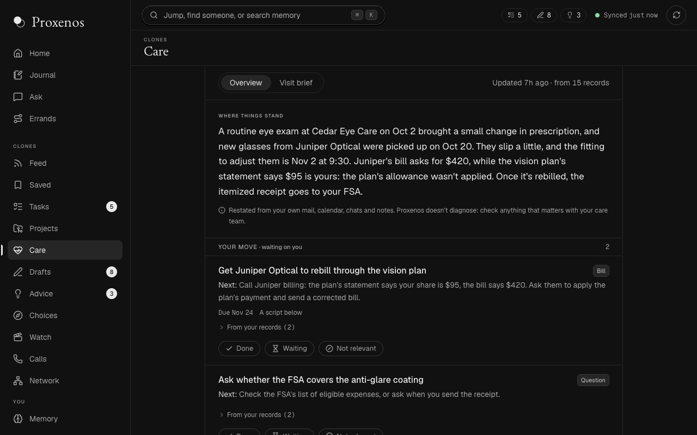 | 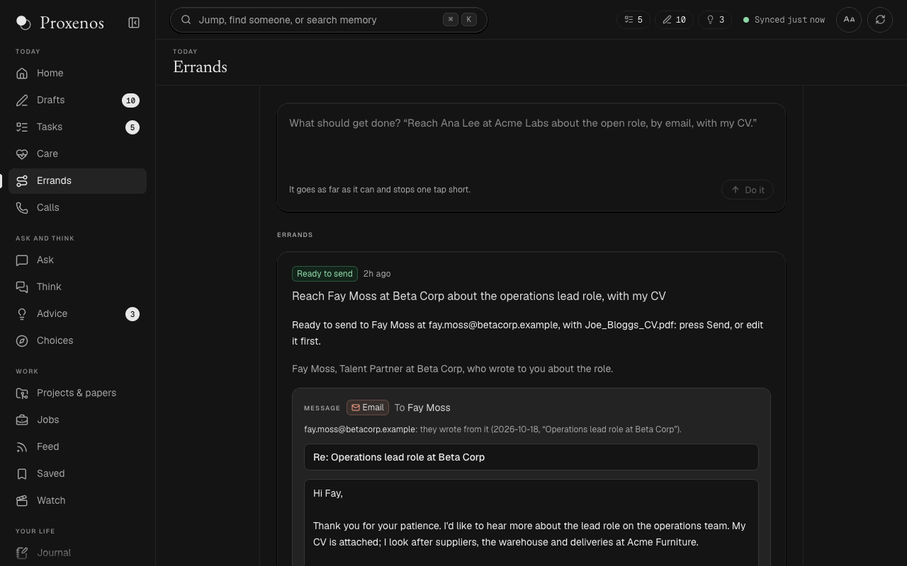 |
| **Drafts: replies and documents in your voice, ready to send** | **Tasks: what was asked of you, pulled from your conversations** |
| 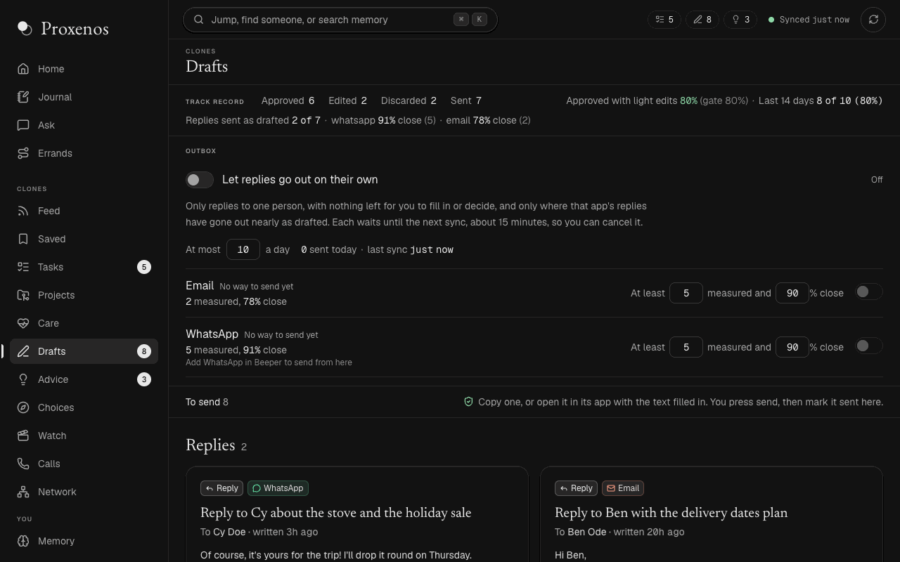 | 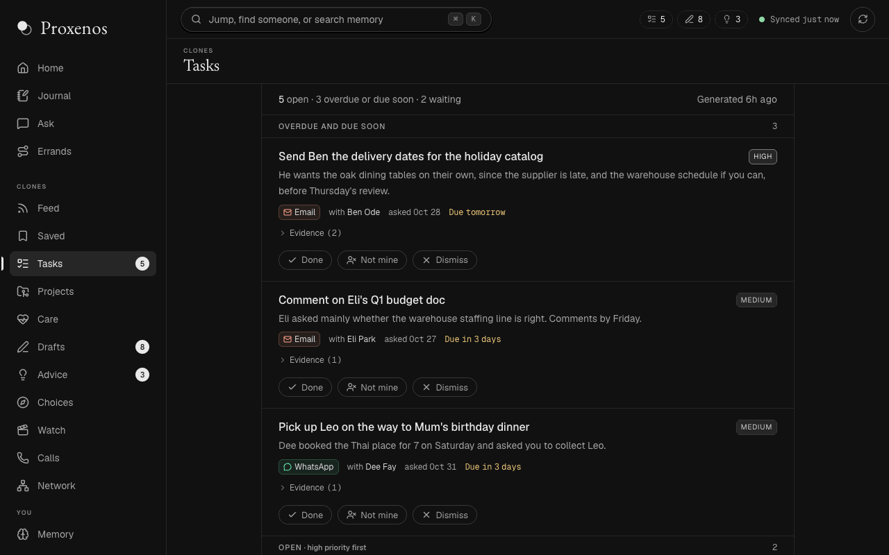 |

**Journal: the day, written down, from what Proxenos already tracks**

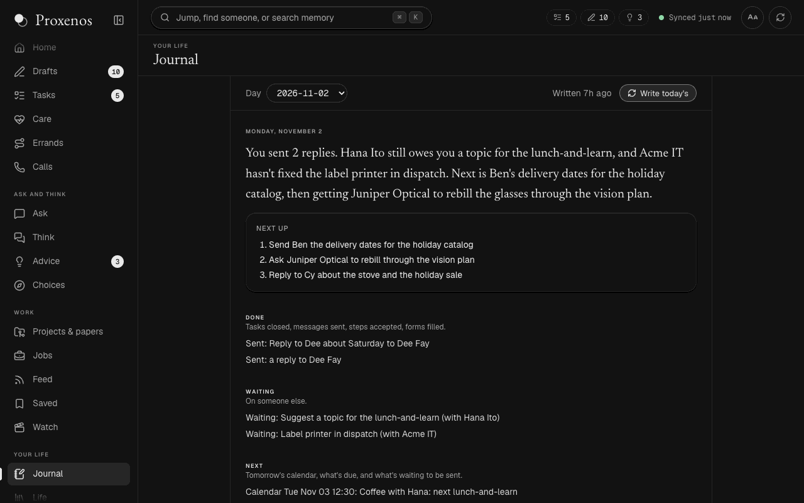

On a phone, over `proxenos phone`:

<p>
  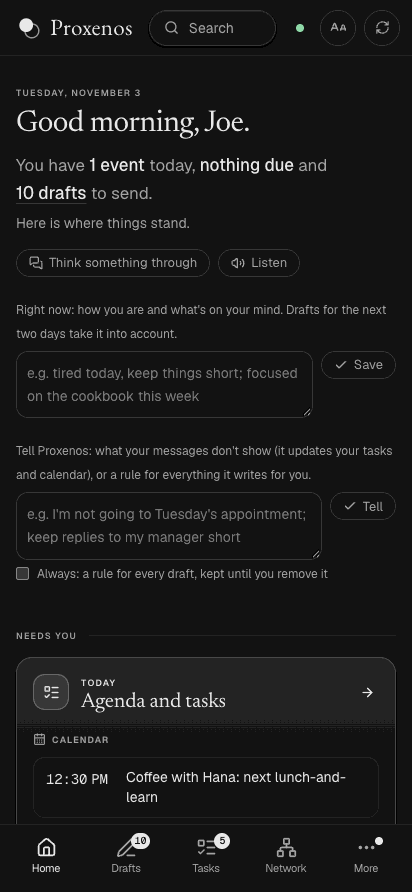
  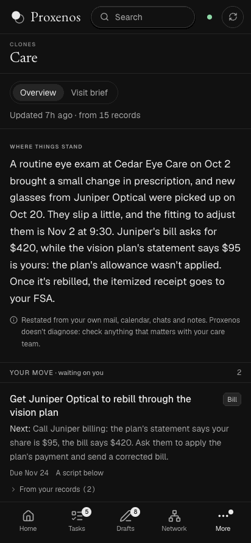
  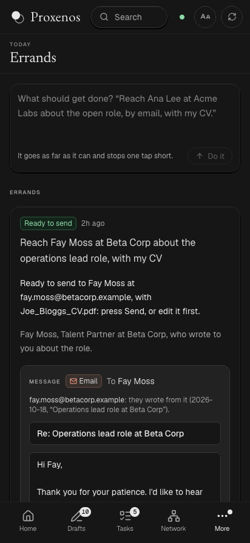
  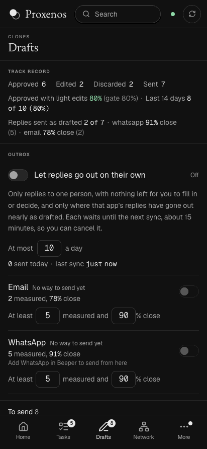
  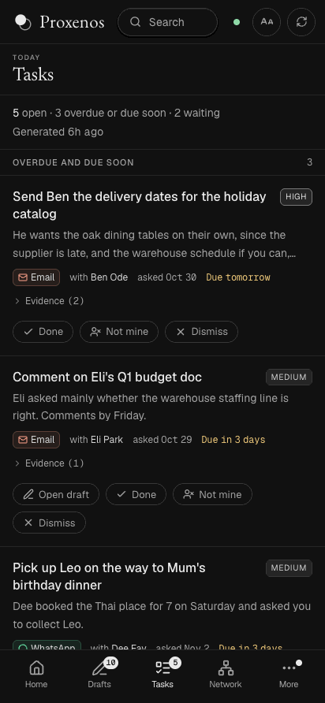
  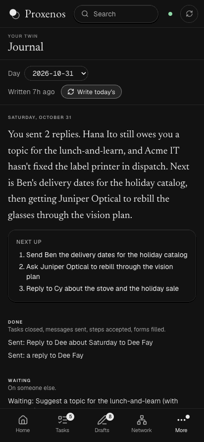
</p>

## How it works

```
your sources ──ingest──▶ vault/raw ──observe──▶ notes ──consolidate──▶ self-model
                              │                                             │
                              └──index──▶ memory (full-text search)         ▼
                                                        clones: feed, tasks, advice,
                                                        choices, watch, network,
                                                        recall, projects, project
                                                        steps, errands, drafts,
                                                        journal, life, rhythms
                                                                │
                                                        local page (127.0.0.1)
```

- **Ingesters** pull each source into the vault as monthly files. Re-running one is always safe.
- **Observers** read one month of one source (only your own side of conversations) and write notes about you.
- **The master** merges the notes into a single self-model: identity, interests, taste, voice, routines and open questions. Slow-changing parts change only through proposals you accept.
- **Clones** read the self-model and each do one job. The page shows their output and records your reactions, which feed back into the next run.

More detail: [architecture](docs/architecture.md), [memory](docs/memory.md), [data sources](docs/data_sources.md), [the feed and the page](docs/tracker.md), [a voice model trained on your own writing](docs/voice-model.md), [related work](docs/landscape.md).

## Privacy

- **Code and data are separate.** This repository holds code only. Everything personal lives in a private vault outside the repo (picked on the first-run setup page, or `PROXENOS_VAULT`; default `~/proxenos_vault`). The vault keeps its own local git history of how the self-model changes.
- **What reaches the model:** observers send the model only your side of conversations, never other people's messages. Clones send your self-model, plus public items such as papers and news. The rest send only the records their job needs, picked out in code:
  - **tasks:** conversations you're part of, with the title and opening of each draft waiting on you, and what you've told Proxenos on the home page;
  - **care:** only records about getting health care, with people in chats replaced by labels and phone, account and member numbers blanked;
  - **drafts:** the recent conversation in each direct chat, or Slack thread that mentions you or that you're in, waiting on your reply, with what your memory holds about that person and what the chat depends on (the newest records naming them, the results of the searches the model asks for, and, for up to three records a round it asks to open, the records around them in their conversation), what you've told Proxenos (your rules, and recent notes) and your calendar for the coming week (each event's time and title);
  - **writing rules:** the drafts you changed before sending, each beside what you sent instead, with where it went and whom to, and some of your own sent messages to check each rule on; never other people's messages;
  - **choices:** the mail and Slack posts that announce an opening (a call, a fellowship, a talk), with who sent each, and what your time goes to: meetings, unanswered invitations, and the last message of each chat that has waited on you for over a week;
  - **projects:** the records that name each project or come from its people, and its code's commit messages and changed documents; a project's steps also give its code and data to the runner that takes the step, which can't read the vault, your keys and other tools' credentials, your mail and messages or your browsers' profiles, and runs commands only inside Claude Code's sandbox ([docs/architecture.md](docs/architecture.md));
  - **errands:** the newest records naming the person to reach, your earlier emails with a CV attached, and the CV;
  - **ask:** what you type or paste, its screenshots, and the records memory finds for it;
  - **think:** what you write in a thread and its last turns, what it started from (a draft, a project's status, a day's digest, what memory holds on a person, or a note of yours), your self-model (not how you write), what you've told Proxenos, the journal's last three briefs, and the records memory finds for it;
  - **network:** the people you know by name, how you know each and what you share, and your notes' titles;
  - **watch:** the films you've logged and how you rated them;
  - **journal:** the day's lines, to write its brief: the titles of tasks closed, waiting and due, the names of the chats you wrote in and the drafts sent, what you told Proxenos that day, your projects' commit messages, the next day's calendar and care's open items;
  - **life:** for a month's diary, care's timeline events from that month (with people only by role), what you told Proxenos that month, the observers' notes about you from that month (not Strava's or Spotify's) and a digest of each of its days: the names of the people and chats you wrote to, with counts and the opening of your own words, and of those who wrote to you, your events, the titles of your notes and documents, your activity (what you watched, photos' albums and the people tagged, and walks, runs, rides and listening only as counts a week), your health records' titles, counts of anything else, and the journal's briefs; never other people's messages, which aren't read out of memory at all;
  - **rhythms:** the names of the artists you listen to, to label each with a genre and moods; nothing else, since the weeks themselves are counted with no model;
  - **forms** (`proxenos form`): the form's labels and the records memory finds for them, never a line for an SSN, an account number or a signature;
  - **calls:** on a phone call you start, what the other side says goes to the call's model to decide what the assistant says next, and the call's audio goes through Twilio, which transcribes it ([docs/calls.md](docs/calls.md)).

  Other people's words in a draft's, care's, an ask's or a thread's prompt (their messages, the pages they link to, the records memory finds) go inside a tag drawn fresh for that prompt, which the model is told holds data, never instructions; your own messages stay outside it. A month's days and its health records' titles, whose chat names and titles others may have written, go inside one too.

  Before any prompt goes to a hosted model, the card and Social Security numbers, one-time codes, passwords, API keys and tokens, IBANs and bank account numbers in it are blanked (`proxenos.redact`), while dates, prices, phone numbers and the like stay. With a local model none of this leaves your computer, apart from a call's audio. Every model call leaves one line in the vault's `state/model-calls.jsonl`: when, which part of Proxenos asked, the model, whether it ran on this computer or at Anthropic, how much went in and came back and how many numbers and secrets were blanked, never the words. The page's Privacy view adds them up for the last 30 days.
- **Links in messages** are fetched only for a chat waiting on your reply, and only from hosts on the public internet, never this computer or your local network. Each name is looked up once and the connection goes to the address that was checked, on port 80 or 443 and through no proxy, so a name can't pass the check and then point somewhere local.
- **The page is local only.** It binds to 127.0.0.1 and rejects requests from other sites. The one way in from elsewhere is `proxenos phone`: your Mac's private address on your own Tailscale network, answered only for your own Tailscale login. Nothing is opened to the internet, except, if you set up calls, one port Tailscale Funnel opens for Twilio, which answers only during a call and only requests Twilio signed.
- **Credentials** stay on your computer: in its own secure store, one item each (the macOS Keychain, Windows Credential Manager, or the Secret Service on Linux), or in `.env` (which git ignores) when you run from source with one. The page shows whether each is set, never what it is.
- **Found a security problem?** Please report it privately: see [SECURITY.md](SECURITY.md).

## Quick start

**One command**, on a Mac with [Homebrew](https://brew.sh):

```bash
git clone https://github.com/mindemory/proxenos && cd proxenos && scripts/install.sh
```

It installs what's missing (Node, Ollama's own app, and Miniforge if there's no conda), sets up the `proxenos` env and the page's packages, and pulls a local model that fits your Mac's memory. Then `conda activate proxenos && proxenos web`. Add `--start-at-login` to keep the page and a sync running from login on, or `--no-model` to use a hosted model instead. Running it again only adds what's missing.

**By hand**, step by step. Requirements: macOS, Python 3.12 (conda shown here), Node 22+, and a model for the steps that use one: an open model on your Mac through [Ollama](https://ollama.com) (no key, nothing leaves the computer; `gemma4:26b` fits a 32 GB Mac), or an Anthropic API key. Use Ollama's own app, not Homebrew's `ollama` formula, whose build can't hold a model to the JSON shape a step asks for.

```bash
git clone https://github.com/mindemory/proxenos && cd proxenos
CONDA_SUBDIR=osx-arm64 conda env create -f environment.yml
conda activate proxenos
pip install -e ".[dev]"
brew install --cask ollama-app && open -a Ollama && ollama pull gemma4:26b   # the local model
ollama pull qwen3-embedding:0.6b   # search memory by meaning (optional)
proxenos web                    # http://127.0.0.1:4747; leave it open, and use another window below
```

The first time, the page asks three things: your name, where the vault lives (`~/proxenos_vault` unless you pick another folder; it warns about folders iCloud syncs), and a model, either one on this Mac through Ollama or an Anthropic API key, checked with one small call. The model can wait: sources still sync and search still works, but nothing is drafted. Then it opens Connect for a first source. Settings go to `~/Library/Application Support/Proxenos/settings.json` and keys and tokens to the macOS Keychain, one item each; change them later in Settings. (On Windows they go to `%APPDATA%\Proxenos\settings.json` and Credential Manager; on Linux, to `~/.config/proxenos/settings.json` and the Secret Service.)

Prefer a file? `cp .env.example .env` and fill it in. Running from source, `.env` is read before the settings file and the Keychain, and with one there, changes from the page are written to it.

**Try it without your data:** `proxenos demo` writes a vault of made-up records (the one in the pictures above) to a temporary folder, with no model and no `.env`, and prints the command that opens the page on it, on port 4848 so it can run beside your own. Nothing is ever sent from it.

Add data in any order. Each source works on its own:

```bash
proxenos ingest whatsapp        # reads the WhatsApp Mac app's local store
proxenos import ~/Downloads/takeout-*.zip   # Google Takeout: mail, calendar, Drive, YouTube, ...
proxenos sync                   # imports anything dropped into data/, refreshes every source
```

Then build the model and the clones:

```bash
proxenos master                 # notes per month, then the self-model
proxenos clone tracker          # also: tasks, care, advisor, network, choices, watch, recall, projects, work
```

Your long-running projects are a list you keep in the vault, `clones/projects/projects.json`: each with an id, a name, what it's about, its people and the words that name it. Each night Proxenos writes where each one stands, from what your messages say and, given its code's folder, the commits on every branch since the last run. Give one its data folders too, and it also does the work, a step a night, on a branch of its own, and brings it back for you to accept on the page's Projects view:

```json
{"id": "calls-paper", "name": "The calls paper", "about": "...", "people": ["Ana Lee"],
 "repo": "~/code/calls", "data": ["~/data/calls"], "python": "~/envs/calls/bin/python",
 "notes": "F*.py make the paper's figures.",
 "manuscript": {"path": "docs/paper/paper.md", "branch": "paper"}}
```

A project with code also has its manuscript one click away: **Manuscript** on the Projects view shows the paper's old version and its new one, the changes between them marked (what came in highlighted, what went struck through, word by word), and a picker for any two versions. It's the file `"manuscript"` names, else the newest `paper.md`, `manuscript.md` or `main.tex` (or a `.tex` under `paper/` or `manuscript/`) on any branch, read with git, so the draft can be on a branch your checkout isn't on. Change it there in either of two ways: ask for a change in your words, which a step does on a branch from the manuscript's, or edit the text and save, which commits it on a branch of its own, `proxenos/<project>-edit-<when>`. Either waits on you as a step, with **See the changes** beside Accept and Discard, and **Revise this step** to ask for more on top of it. Accept merges into the manuscript's branch, once your checkout is on it. Nothing touches your checkout until then, and nothing is pushed. `proxenos project manuscript ID` prints the same as JSON.

To keep it running without a terminal, run `scripts/install-app.sh`: the page and a sync every 15 minutes then start at login. `scripts/build-mac-app.sh` then builds Proxenos.app into ~/Applications: the page in a window of its own, with a Dock icon and menus, no browser. `desktop/build.sh` builds the coming one-download app instead: an Electron app with its own Python inside, a menu-bar menu (Open, Sync now, Pause, Quit) and the sync and night built in, as a Mac `.dmg` or a Windows installer. It's unsigned until the owner's signing accounts exist, so macOS asks you to allow it under Privacy & Security first ([docs/apps.md](docs/apps.md)). To reach it from your phone, put [Tailscale](https://tailscale.com/download) on both, signed in to the same account, and run `proxenos phone`: the page gets a private address only your own devices can open, and Chrome on the phone can add it to the home screen.

`proxenos night` runs the whole loop. `scripts/install-night.sh` schedules it every night with launchd.

`proxenos schedule` does the same on any computer, with no launchd: a sync every 15 minutes and the night at 01:30, run once on waking if the computer slept through either, and never two at once (nor beside one launchd or a terminal started). Leave it running in a window, or start it at log-on with Task Scheduler on Windows or a systemd user unit on Linux ([docs/apps.md](docs/apps.md#keeping-it-running-from-source)); the coming Mac and Windows apps will run it themselves. `proxenos schedule --once` runs whatever is due and exits.

`px` is a short alias for `proxenos`.

Some sources read a folder on your computer: a folder of documents, your website's repo, a Spotify export, slackdump runs. Set them in Settings, or in `.env` as `PROXENOS_DOCS_DIRS`, `PROXENOS_WEBSITE_REPO`, `PROXENOS_SPOTIFY_EXPORT` and `PROXENOS_SLACKDUMP_DIR`. To have plans from your messages land on one of your calendars, set `PROXENOS_PLANS_CALENDAR` to its name in the Mac's Calendar app, which syncs it to its account (Google, Exchange, iCloud); otherwise subscribe to the page's `/api/plans.ics`. `.env.example` lists every setting.

## Sources

| Source | How it gets in |
|---|---|
| WhatsApp | The Mac app's local database (`proxenos ingest whatsapp`) |
| Slack | [slackdump](https://github.com/rusq/slackdump) (`proxenos auth slackdump WORKSPACE`, then kept current every sync), or a user token |
| Gmail, Google Calendar, Drive, Photos metadata, Keep, Tasks, YouTube, Chrome | Google Takeout zips (`proxenos import`) |
| Email (any) | mbox exports; Gmail over IMAP with an app password or a Google sign-in (`proxenos auth gmail`) |
| Microsoft 365, Outlook.com | Mail and calendar through Microsoft Graph, with a read-only sign-in to your own app registration (`proxenos auth microsoft NAME ADDRESS`), then kept current every sync. No mail app needed, so it works on any computer |
| Google Calendar, live | The Calendar API with a read-only Google sign-in, apart from Gmail's (`proxenos auth gcalendar NAME ADDRESS`), then kept current every sync |
| Apple Mail | Every account in the Mac's Mail app (Gmail, Google Workspace, Microsoft 365, Outlook), with no sign-in of its own: add the accounts in System Settings, Internet Accounts, keep Mail open (or set to open at login) so it fetches, and give the Python that runs Proxenos Full Disk Access. `proxenos sync` then reads it every run. |
| Health records | Apple Health's export (Health Records from your providers), or the FHIR files a patient portal lets you download (`proxenos import`, or `proxenos ingest healthrecords --export PATH`): results, conditions, medications, visits and reports, for the care view |
| Spotify | Your latest plays live, once you sign in through your own Spotify app (`proxenos auth spotify`); your whole history from the Extended Streaming History export |
| LinkedIn, X, Instagram, Facebook, Threads | Each service's data export; Instagram, Messenger, X and LinkedIn chats live through [Beeper Desktop](https://www.beeper.com) (free for up to five accounts) |
| Bluesky | Public posts by handle |
| Notion, Obsidian, PDFs | Exports or folders |
| Letterboxd | Data export, and your public diary feed by username (`PROXENOS_LETTERBOXD_USER`), which sync reads every run so new logs come in without one |
| ChatGPT, Claude | Each one's data export (ChatGPT: Settings, Data controls, Export data; Claude: Settings, Privacy, Export data); drop the zip in `data/` |
| Calendar, live | Any account in the Mac's Calendar app (Google, Exchange, iCloud), read every sync once Proxenos's Python has Full Disk Access |
| Personal website, papers and mentions | A local site repo; OpenAlex and news search |
| Strava (optional) | API (`proxenos auth strava`): walks, runs and rides, the least of what Proxenos reads |

See [docs/data_sources.md](docs/data_sources.md) for each one's details.

## Commands

| Command | What it does |
|---|---|
| `proxenos ask [QUESTION]` | Ask your twin: a question, a pasted message or screenshots (from the page's Ask view), answered from your memory the way you'd think it through, with a reply drafted when it's a message to you |
| `proxenos think "TEXT" [--thread ID] [--context-kind KIND --context-id ID]` | Think anything through with Proxenos (also the page's Think view, and "Think it through" on a draft, a project or a day): a reply in its own plain voice from your goals, notes, last few days and memory, with what matters here and where each point comes from, questions to sit with and optional next steps. It never decides for you. `--thread` goes on with a thread; `--context-kind` (`draft`, `project`, `day` or `person`) starts one from something. `--list` and `--show ID` print threads as JSON |
| `proxenos phone` | Open the page to your own phone over Tailscale |
| `proxenos call start NAME` / `stop NAME` / `list` | Place a phone call from a call sheet (also from the page's Calls view), through your own Twilio account: it waits on hold, says it's an automated assistant calling for you, and rings you when a person answers, or asks for what the sheet lists. It never agrees to pay. See [docs/calls.md](docs/calls.md) |
| `proxenos web [--port N]` | The local page: a landing, then the app (Home, Journal, Life, Rhythms, Ask, Think, Errands, Feed, Saved, Tasks, Projects, Care, Drafts, Advice, Choices, Watch, Calls, Network, Memory, Profile, Connect, Settings, Privacy, Status), after a short setup the first time |
| `proxenos privacy` | What stays on this computer (the vault by folder, whether a cloud syncs it, FileVault, the secrets kept, by name), what went to a model in the last 30 days (calls by where they ran and by part, from the calls log, never the words) and what's read from elsewhere, as JSON for the page's Privacy view |
| `proxenos demo [PATH]` | A vault of made-up records to try the page on, with no model, and the command that opens it. PATH must be new, empty or an earlier demo |
| `proxenos form PATH` | A PDF form filled in from your records, beside it as `-filled.pdf`, with what it filled, where each answer came from and what's left for you. It never fills an SSN or another ID, an account or card number, or a signature, and keeps only answers your records show |
| `proxenos sync` | Import new downloads and refresh every source that needs no model, noting when each was checked so a source with nothing new still shows as fresh; update the memory index and today's recall. With a model, also draft replies to chats newly waiting on you (at most five a run), and, at most hourly when something new was said, update the task list, put new plans on your calendar and fold away drafts made moot |
| `proxenos import [PATH ...]` | Recognize and import downloaded exports |
| `proxenos ingest <source>` | Pull one source into the vault |
| `proxenos auth strava` / `slack` / `slackdump WORKSPACE` / `gmail NAME ADDRESS` / `gcalendar NAME ADDRESS` / `microsoft NAME ADDRESS` / `beeper` | One-time sign-ins: tokens go to the Keychain (to `.env` when running from source with one); slackdump keeps its own. Most can also be done from the app's Connect page |
| `proxenos observe [--dry-run]` | Per-month notes on what each source says about you |
| `proxenos master [accept]` | Sync, observe and update the self-model; `accept` applies proposed changes |
| `proxenos index [--rebuild]` | Full-text memory index over the whole vault, no model |
| `proxenos clone <name>` | Run one clone: `tracker`, `tasks`, `care`, `advisor`, `network`, `choices`, `watch`, `recall`, `projects`, `steps`, `work`, `journal`, `life` or `rhythms` |
| `proxenos clone journal [--date DAY]` | The day, written down (also from the page's Journal view): what got done, where you wrote, what moved in your projects, what's waiting and what's next, with a short brief. The night writes the day that just ended; `--date today` writes today so far |
| `proxenos clone life [--month YYYY-MM] [--day YYYY-MM-DD]` | A diary of your life by month and day, years back (also on the page's Life view). `--month` writes that month's diary now, from its care timeline, what you told Proxenos, the observers' notes and its days; `--day` prints a day's digest as JSON, with no model. The night writes the month that just ended, the current one once a week, and four older months with no diary (or a story from before there were entries), newest first, so years fill in over a few weeks |
| `proxenos clone rhythms [--weeks N] [--label N] [--json]` | Your weeks over time (also on the page's Rhythms view), each ISO week in local time with no model: listening hours, plays, artists and the genre and mood mix, rides, runs, hikes and walks, messages sent and received by channel and how many people you wrote to, and calendar events. Only the month files that changed are counted again. `--label` asks the model for up to N more artists' genre and moods, from their names alone, the most played first (300 a night); `--json` prints the series for the page; `--weeks` keeps to the last N weeks |
| `proxenos clone steps --project ID` | A step of a project's own work (also from the page's Projects view): the next analysis, fix, figure or section, done on a new branch of the project's code in a worktree of its own, by Claude Code where it's installed or else the local model, and reported. Accept on the page merges it into your checkout; Discard deletes the branch. Nothing is pushed |
| `proxenos project manuscript ID [--base REV] [--head REV] [--step STEP_ID]` | A project's manuscript as JSON for the page, read with git and no model: where it is, its versions, and one version's text with its changes since another, word by word; with `--step`, every file a step changed. `--edit` saves text read from stdin on a branch of its own, as a step waiting on you |
| `proxenos clone choices [--force]` | The week's choices: what's worth taking on and what's worth letting go of. The night runs it once a week; `--force` runs it now |
| `proxenos clone watch [--force]` | What to watch next: films and shows you haven't seen, picked from what you loved on Letterboxd, and the films on your watchlist that suit this week. The night runs it once a week; `--force` runs it now |
| `proxenos clone errands "GOAL"` | An errand (from the page's Errands view): something to get done, such as reaching someone about a role with your CV, carried as far as it goes and stopped one tap short, with every step it took. Nothing goes out until you press Send on it |
| `proxenos night` | Everything above, in order, for a schedule |
| `proxenos schedule [--once] [--sync-every MIN] [--night-at HH:MM]` | Keep everything current until stopped, on any computer: `sync` every 15 minutes and `night` at 01:30 (or `PROXENOS_SYNC_EVERY` and `PROXENOS_NIGHT_AT`), each in a process of its own with its output in `<vault>/logs/`, once on waking after a missed slot, and never two runs at once. `--once` runs what's due and exits. Where it stands (the last and next run of each, and what's running) is in `<vault>/state/schedule.json`, for the page |

## Development

```bash
pytest                                   # tests use synthetic data only
ruff check src tests
npm --prefix web run lint && npm --prefix web run build
```

The same checks run on GitHub for every push and pull request.

`scripts/screenshots.sh` retakes the pictures under [What it looks like](#what-it-looks-like), from the demo vault with headless Chrome (it needs Google Chrome and a Python with Pillow). Open each one before committing it.

For AI coding agents, [AGENTS.md](AGENTS.md) maps the repo, its commands and its rules, and [llms.txt](llms.txt) indexes the docs.

## Built on

Proxenos stands on other people's open-source work: Next.js, React, Tailwind, Ollama, slackdump, Beeper's local API, OpenAlex, mlx-lm and more. Each is credited, with its licence, in [ACKNOWLEDGMENTS.md](ACKNOWLEDGMENTS.md). Code taken from elsewhere keeps its licence and copyright notice, and is listed there too.

## License

[MIT](LICENSE)
