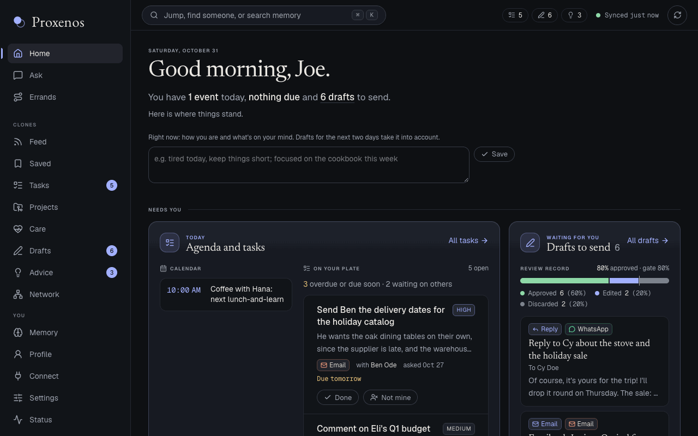
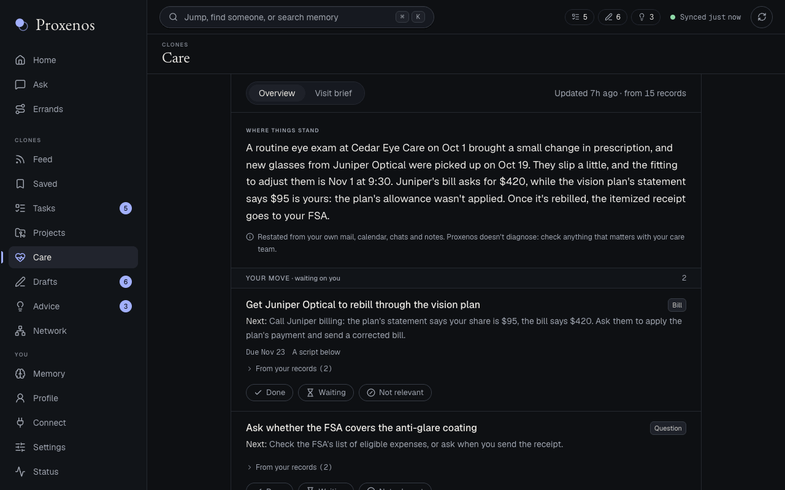
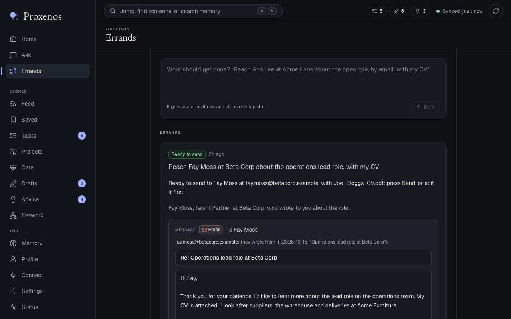
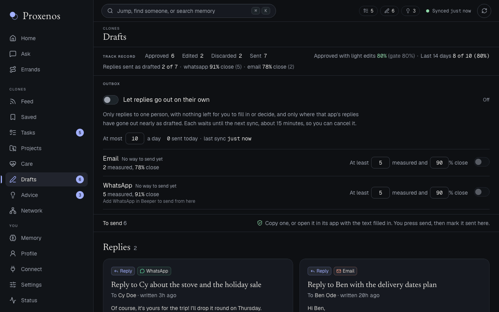
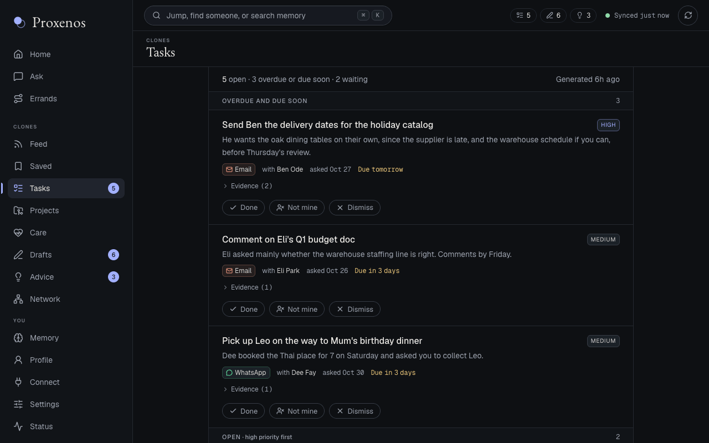
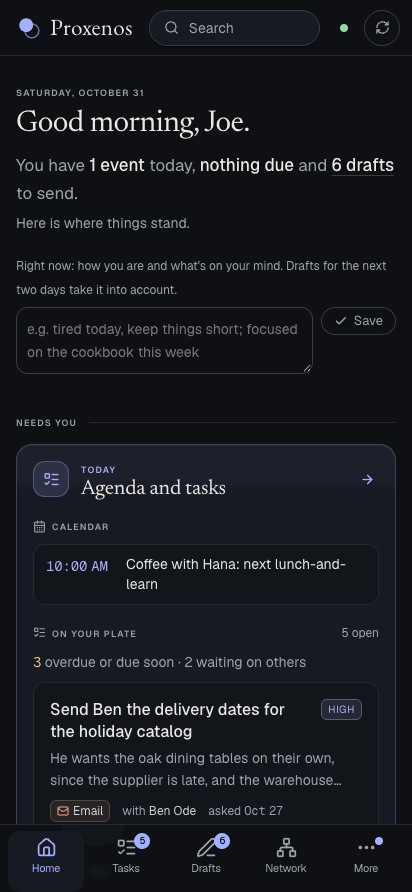
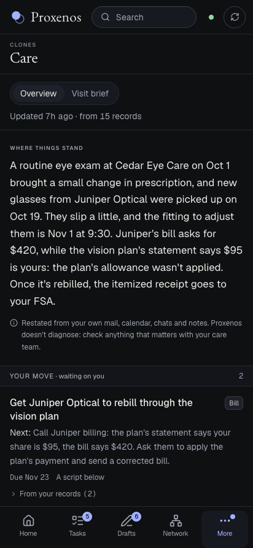
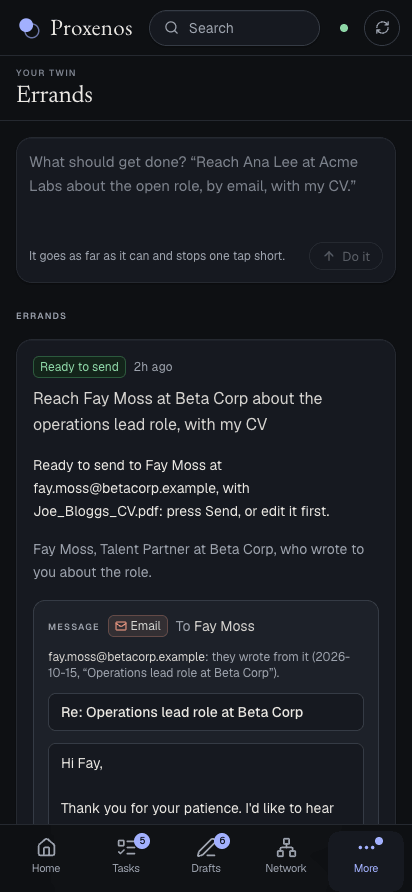
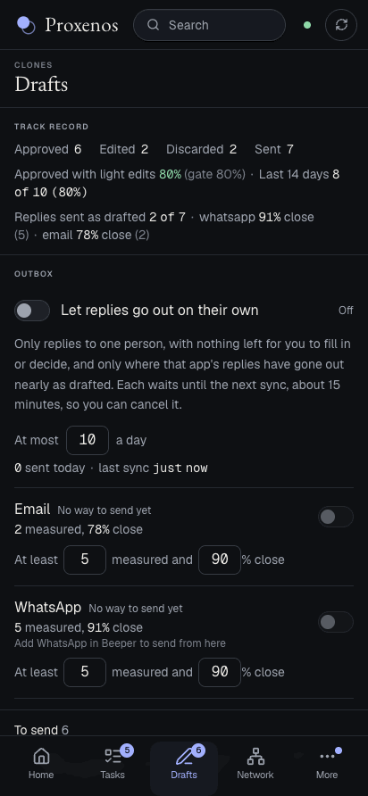
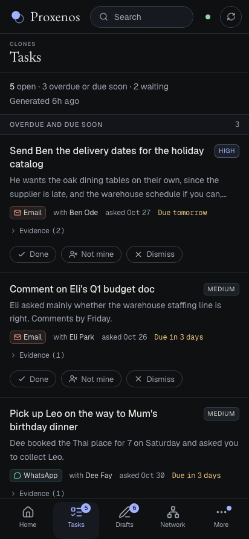

# Proxenos

[](https://github.com/mindemory/proxenos/actions/workflows/checks.yml)


[](LICENSE)

[](https://github.com/mindemory/proxenos/stargazers)
[](https://hub.xerj.org/contributors/mindemory)

**A free, open-source agent that keeps your own records private on your computer and drafts the next step for you. Built first for people getting through the health care system.**

When you're unwell, the hard part is often everything around the care: referrals that go quiet, portals, bills that don't match, forms, and the same story told again at every visit. Proxenos reads what you already have (your mail, chats, calendar and notes), keeps track of where things stand, and writes the message, the call script or the one-page brief for your next appointment, in your own voice. You stay in charge: it drafts, and you press send.

It grew out of one person's weeks of getting through the system while unwell. The story is [Try anything, but don't fall sick](https://mrugankdake.substack.com/p/try-anything-but-dont-fall-sick), and more on the project is at [mindemory.io/proxenos](https://www.mindemory.io/proxenos).

> **Status: early, and used every day by one person.** It runs on a Mac (Apple Silicon) for someone comfortable with a terminal, and every check passes from a fresh clone. It isn't yet something you can download and use without code. That's the next track: one download, signing in instead of configuring, and a clear privacy screen ([docs/everyone.md](docs/everyone.md)). Expect rough edges, and readers that assume a particular export format.
>
> **Help of any kind is welcome:** code, an issue, or an idea over a message or a call. Healthcare comes first, so people with medical training are especially welcome. Knowing what's worth tracking and what to ask is what would make this preventive, not just a way through the system. Good places to start are in [CONTRIBUTING.md](CONTRIBUTING.md#good-first-contributions). If you'd like Proxenos to exist for more people, a star helps others find it.

> **Not medical advice.** Proxenos organizes your own records and drafts messages. It doesn't diagnose or recommend treatment: the care view restates what your records say, and anything that matters belongs with your care team.

Proxenos gathers your own data (messages, email, calendar, notes, documents, activity) into one private vault on your computer. From that it keeps a written model of who you are, and runs small agents ("clones") that work for you:
- a feed of new papers and news, ranked for you;
- your open tasks, pulled from your conversations;
- where your health care stands: a timeline, what's still open, what to say on the phone, and a one-page brief for your next appointment;
- advice grounded in your own patterns;
- a map of the people you know and how they connect;
- a searchable memory that brings the right past messages and notes to mind;
- drafts of replies, emails and plans, written in your voice: a reply for each chat waiting on you, in the way you write to that person, after reading any link they sent.

It drafts; by default it never sends, posts or buys anything by itself. You copy a draft or open it in its app with the text filled in, and press send yourself; once your reply shows up in that chat, the draft is marked sent. An outbox you switch on per app lets replies go out on their own, only where that app's drafts have gone out nearly unchanged many times, with a window to cancel each one ([docs/memory.md](docs/memory.md)). The longer-term plan, moving from drafting to acting on approval to acting within rules you set, is in [docs/roadmap.md](docs/roadmap.md).

*The name: in the Greek city-states, a proxenos was the citizen who formally acted on someone else's behalf.*

## What it looks like

These come from `proxenos demo` (see [Quick start](#quick-start)): a made-up person, Joe Bloggs, and his made-up records. None of it is real.



| Care: where things stand, what's yours to do, what to say | Errands: carried as far as they go, one tap short of sending |
|---|---|
|  |  |
| **Drafts: replies and documents in your voice, ready to send** | **Tasks: what was asked of you, pulled from your conversations** |
|  |  |

On a phone, over `proxenos phone`:

<p>
  
  
  
  
  
</p>

## How it works

```
your sources ──ingest──▶ vault/raw ──observe──▶ notes ──consolidate──▶ self-model
                              │                                             │
                              └──index──▶ memory (full-text search)         ▼
                                                        clones: feed, tasks, advice,
                                                        network, recall, projects,
                                                        project steps, errands, drafts
                                                                │
                                                        local page (127.0.0.1)
```

- **Ingesters** pull each source into the vault as monthly files. Re-running one is always safe.
- **Observers** read one month of one source (only your own side of conversations) and write notes about you.
- **The master** merges the notes into a single self-model: identity, interests, taste, voice, routines and open questions. Slow-changing parts change only through proposals you accept.
- **Clones** read the self-model and each do one job. The page shows their output and records your reactions, which feed back into the next run.

More detail: [architecture](docs/architecture.md), [memory](docs/memory.md), [data sources](docs/data_sources.md), [the feed and the page](docs/tracker.md), [a voice model trained on your own writing](docs/voice-model.md), [related work](docs/landscape.md).

## Privacy

- **Code and data are separate.** This repository holds code only. Everything personal lives in a private vault outside the repo (picked on the first-run setup page, or `PROXENOS_VAULT`; default `~/proxenos_vault`). The vault keeps its own local git history of how the self-model changes.
- **What reaches the model:** observers send the model only your side of conversations, never other people's messages. Clones send your self-model, plus public items such as papers and news. Three clones also send recent records they need, picked out in code: tasks sends conversations you're part of; care sends only records about getting health care, with people in chats replaced by labels and phone, account and member numbers blanked; and drafts sends the recent conversation in each direct chat, or Slack thread that mentions you or that you're in, waiting on your reply, with what your memory holds about that person and what the chat depends on (the newest records naming them, and the results of the searches the model asks for). With a local model none of this leaves your computer.
- **Links in messages** are fetched only for a chat waiting on your reply, and only from hosts on the public internet, never this computer or your local network.
- **The page is local only.** It binds to 127.0.0.1 and rejects requests from other sites. The one way in from elsewhere is `proxenos phone`: your Mac's private address on your own Tailscale network, answered only for your own Tailscale login. Nothing is opened to the internet.
- **Credentials** stay on your computer: in its own secure store, one item each (the macOS Keychain, Windows Credential Manager, or the Secret Service on Linux), or in `.env` (which git ignores) when you run from source with one. The page shows whether each is set, never what it is.
- **Found a security problem?** Please report it privately: see [SECURITY.md](SECURITY.md).

## Quick start

Requirements: macOS, Python 3.12 (conda shown here), Node 22+, and a model for the steps that use one: an open model on your Mac through [Ollama](https://ollama.com) (no key, nothing leaves the computer; `gemma4:26b` fits a 32 GB Mac), or an Anthropic API key.

```bash
git clone https://github.com/mindemory/proxenos && cd proxenos
CONDA_SUBDIR=osx-arm64 conda env create -f environment.yml
conda activate proxenos
pip install -e ".[dev]"
brew install ollama && brew services start ollama && ollama pull gemma4:26b   # the local model
ollama pull qwen3-embedding:0.6b   # search memory by meaning (optional)
proxenos web                    # http://127.0.0.1:4747; leave it open, and use another window below
```

The first time, the page asks three things: your name, where the vault lives (`~/proxenos_vault` unless you pick another folder; it warns about folders iCloud syncs), and a model, either one on this Mac through Ollama or an Anthropic API key, checked with one small call. The model can wait: sources still sync and search still works, but nothing is drafted. Then it opens Connect for a first source. Settings go to `~/Library/Application Support/Proxenos/settings.json` and keys and tokens to the macOS Keychain, one item each; change them later in Settings. (On Windows they go to `%APPDATA%\Proxenos\settings.json` and Credential Manager; on Linux, to `~/.config/proxenos/settings.json` and the Secret Service.)

Prefer a file? `cp .env.example .env` and fill it in. Running from source, `.env` is read before the settings file and the Keychain, and with one there, changes from the page are written to it.

**Try it without your data:** `proxenos demo` writes a vault of made-up records (the one in the pictures above) to a temporary folder, with no model and no `.env`, and prints the command that opens the page on it, on port 4848 so it can run beside your own. Nothing is ever sent from it.

Add data in any order. Each source works on its own:

```bash
proxenos ingest whatsapp        # reads the WhatsApp Mac app's local store
proxenos import ~/Downloads/takeout-*.zip   # Google Takeout: mail, calendar, Drive, YouTube, ...
proxenos sync                   # imports anything dropped into data/, refreshes every source
```

Then build the model and the clones:

```bash
proxenos master                 # notes per month, then the self-model
proxenos clone tracker          # also: tasks, care, advisor, network, recall, projects, work
```

Your long-running projects are a list you keep in the vault, `clones/projects/projects.json`: each with an id, a name, what it's about, its people and the words that name it. Each night Proxenos writes where each one stands. Give one its code's folder and its data folders, and it also does the work, a step a night, on a branch of its own, and brings it back for you to accept on the page's Projects view:

```json
{"id": "calls-paper", "name": "The calls paper", "about": "...", "people": ["Ana Lee"],
 "repo": "~/code/calls", "data": ["~/data/calls"], "python": "~/envs/calls/bin/python",
 "notes": "F*.py make the paper's figures."}
```

To keep it running without a terminal, run `scripts/install-app.sh`: the page and a sync every 15 minutes then start at login. `scripts/build-mac-app.sh` then builds Proxenos.app into ~/Applications: the page in a window of its own, with a Dock icon and menus, no browser. To reach it from your phone, put [Tailscale](https://tailscale.com/download) on both, signed in to the same account, and run `proxenos phone`: the page gets a private address only your own devices can open, and Chrome on the phone can add it to the home screen.

`proxenos night` runs the whole loop. `scripts/install-night.sh` schedules it every night with launchd.

`proxenos schedule` does the same on any computer, with no launchd: a sync every 15 minutes and the night at 01:30, run once on waking if the computer slept through either, and never two at once (nor beside one launchd or a terminal started). Leave it running in a window, or start it at log-on with Task Scheduler on Windows or a systemd user unit on Linux ([docs/apps.md](docs/apps.md#keeping-it-running-from-source)); the coming Mac and Windows apps will run it themselves. `proxenos schedule --once` runs whatever is due and exits.

`px` is a short alias for `proxenos`.

Some sources read a folder on your computer: a folder of documents, your website's repo, a Spotify export, slackdump runs. Set them in Settings, or in `.env` as `PROXENOS_DOCS_DIRS`, `PROXENOS_WEBSITE_REPO`, `PROXENOS_SPOTIFY_EXPORT` and `PROXENOS_SLACKDUMP_DIR`. `.env.example` lists every setting.

## Sources

| Source | How it gets in |
|---|---|
| WhatsApp | The Mac app's local database (`proxenos ingest whatsapp`) |
| Slack | [slackdump](https://github.com/rusq/slackdump) (`proxenos auth slackdump WORKSPACE`, then kept current every sync), or a user token |
| Gmail, Google Calendar, Drive, Photos metadata, Keep, Tasks, YouTube, Chrome | Google Takeout zips (`proxenos import`) |
| Email (any) | mbox exports; Gmail over IMAP with an app password or a Google sign-in (`proxenos auth gmail`) |
| Microsoft 365, Outlook.com | Mail and calendar through Microsoft Graph, with a read-only sign-in to your own app registration (`proxenos auth microsoft NAME ADDRESS`), then kept current every sync. No mail app needed, so it works on any computer |
| Google Calendar, live | The Calendar API with a read-only Google sign-in, apart from Gmail's (`proxenos auth gcalendar NAME ADDRESS`), then kept current every sync |
| Apple Mail | Every account in the Mac's Mail app (Gmail, Google Workspace, Microsoft 365, Outlook), with no sign-in of its own: add the accounts in System Settings, Internet Accounts, keep Mail open (or set to open at login) so it fetches, and give the Python that runs Proxenos Full Disk Access. `proxenos sync` then reads it every run. |
| Strava | API (`proxenos auth strava`) |
| Spotify | Extended Streaming History export |
| LinkedIn, X, Instagram, Facebook, Threads | Each service's data export; Instagram, Messenger, X and LinkedIn chats live through [Beeper Desktop](https://www.beeper.com) (free for up to five accounts) |
| Bluesky | Public posts by handle |
| Notion, Obsidian, PDFs | Exports or folders |
| Letterboxd | Data export |
| ChatGPT, Claude | Each one's data export (ChatGPT: Settings, Data controls, Export data; Claude: Settings, Privacy, Export data); drop the zip in `data/` |
| Calendar, live | Any account in the Mac's Calendar app (Google, Exchange, iCloud), read every sync once Proxenos's Python has Full Disk Access |
| Personal website, papers and mentions | A local site repo; OpenAlex and news search |

See [docs/data_sources.md](docs/data_sources.md) for each one's details.

## Commands

| Command | What it does |
|---|---|
| `proxenos ask [QUESTION]` | Ask your twin: a question, a pasted message or screenshots (from the page's Ask view), answered from your memory the way you'd think it through, with a reply drafted when it's a message to you |
| `proxenos phone` | Open the page to your own phone over Tailscale |
| `proxenos web [--port N]` | The local page: a landing, then the app (Home, Ask, Errands, Feed, Tasks, Projects, Care, Drafts, Advice, Network, Memory, Profile, Connect, Settings, Status), after a short setup the first time |
| `proxenos demo [PATH]` | A vault of made-up records to try the page on, with no model, and the command that opens it. PATH must be new, empty or an earlier demo |
| `proxenos sync` | Import new downloads and refresh every source that needs no model; update the memory index and today's recall. With an API key, also draft replies to chats newly waiting on you (at most five a run) |
| `proxenos import [PATH ...]` | Recognize and import downloaded exports |
| `proxenos ingest <source>` | Pull one source into the vault |
| `proxenos auth strava` / `slack` / `slackdump WORKSPACE` / `gmail NAME ADDRESS` / `gcalendar NAME ADDRESS` / `microsoft NAME ADDRESS` / `beeper` | One-time sign-ins: tokens go to the Keychain (to `.env` when running from source with one); slackdump keeps its own. Most can also be done from the app's Connect page |
| `proxenos observe [--dry-run]` | Per-month notes on what each source says about you |
| `proxenos master [accept]` | Sync, observe and update the self-model; `accept` applies proposed changes |
| `proxenos index [--rebuild]` | Full-text memory index over the whole vault, no model |
| `proxenos clone <name>` | Run one clone: `tracker`, `tasks`, `care`, `advisor`, `network`, `recall`, `projects`, `steps` or `work` |
| `proxenos clone steps --project ID` | A step of a project's own work (also from the page's Projects view): the next analysis, fix, figure or section, done on a new branch of the project's code in a worktree of its own, by Claude Code where it's installed or else the local model, and reported. Accept on the page merges it into your checkout; Discard deletes the branch. Nothing is pushed |
| `proxenos clone errands "GOAL"` | An errand (from the page's Errands view): something to get done, such as reaching someone about a role with your CV, carried as far as it goes and stopped one tap short, with every step it took. Nothing goes out until you press Send on it |
| `proxenos night` | Everything above, in order, for a schedule |
| `proxenos schedule [--once] [--sync-every MIN] [--night-at HH:MM]` | Keep everything current until stopped, on any computer: `sync` every 15 minutes and `night` at 01:30 (or `PROXENOS_SYNC_EVERY` and `PROXENOS_NIGHT_AT`), each in a process of its own with its output in `<vault>/logs/`, once on waking after a missed slot, and never two runs at once. `--once` runs what's due and exits. Where it stands (the last and next run of each, and what's running) is in `<vault>/state/schedule.json`, for the page |

## Development

```bash
pytest                                   # tests use synthetic data only
ruff check src tests
npm --prefix web run lint && npm --prefix web run build
```

The same checks run on GitHub for every push and pull request.

`scripts/screenshots.sh` retakes the pictures under [What it looks like](#what-it-looks-like), from the demo vault with headless Chrome (it needs Google Chrome and a Python with Pillow). Open each one before committing it.

For AI coding agents, [AGENTS.md](AGENTS.md) maps the repo, its commands and its rules, and [llms.txt](llms.txt) indexes the docs.

## Built on

Proxenos stands on other people's open-source work: Next.js, React, Tailwind, Ollama, slackdump, Beeper's local API, OpenAlex, mlx-lm and more. Each is credited, with its licence, in [ACKNOWLEDGMENTS.md](ACKNOWLEDGMENTS.md). Code taken from elsewhere keeps its licence and copyright notice, and is listed there too.

## License

[MIT](LICENSE)
