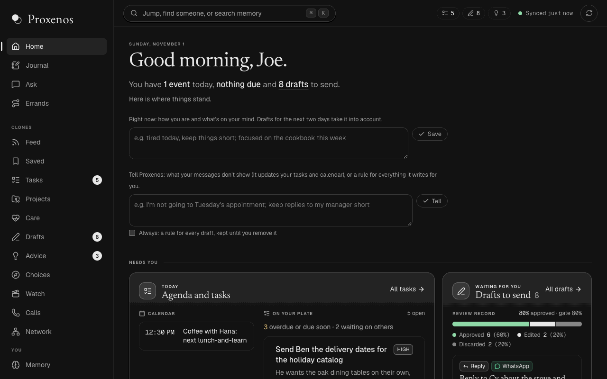

<div align="center">

# Proxenos

A free, open-source personal memory toolbox. Your records stay on your computer; it drafts the next step for you to send.

[](https://github.com/mindemory/proxenos/actions/workflows/checks.yml)
[](LICENSE)
[](https://github.com/mindemory/proxenos/releases/latest)
[](https://github.com/mindemory/proxenos/stargazers)



[](https://github.com/mindemory/proxenos/releases/latest)
[](https://github.com/mindemory/proxenos/releases/latest)

<sub>macOS 13 or newer on Apple silicon (`.dmg`), or Windows x64 (`.exe`). Both are unsigned for now: on a Mac, open System Settings → Privacy & Security → Open Anyway; on Windows, when SmartScreen warns, choose More info → Run anyway.</sub>

</div>

Proxenos reads your own mail, chats, calendars, notes, documents and health records into a private vault on your computer, keeps a written model of who you are, and drafts the next step in your voice: the reply, the plan, the call script, the brief for your next appointment. It was built first for people getting through the health care system, and now it's for anyone.

## Get started

**With the desktop app** (no terminal, no code):

1. Open the [latest release](https://github.com/mindemory/proxenos/releases/latest) and download Proxenos for your computer: the `.dmg` for a Mac with Apple silicon (macOS 13 or newer), or the `.exe` for Windows.
2. On a Mac, open the `.dmg` and drag **Proxenos** into **Applications**. On Windows, run the `.exe`.
3. Open Proxenos. The app isn't signed yet, so your computer warns you the first time. That's expected.
   - Mac: try to open it once. Then open **System Settings → Privacy & Security**, scroll down to the message about Proxenos, and press **Open Anyway**.
   - Windows: when SmartScreen warns, press **More info**, then **Run anyway**.
4. Follow the screens. Setup asks for your name, where to keep your vault (the folder that holds your records; the suggested one is fine), and which model should write for you. The last screen is a short checklist. Do the lines you want now, and the rest later from **Connect**.

You'll see Home when setup is done, and a menu-bar icon (Mac) or tray icon (Windows). Its menu has **Sync now**. A model comes first: without one, your sources still sync but nothing is drafted. Setup downloads a small open one with one button, or you can paste a key (a password-like code) from Anthropic, OpenAI or Google Gemini instead. If a Mac says it "can't be opened", that's step 3: use **Open Anyway**.

**From source**, for developers, on a Mac with [Homebrew](https://brew.sh):

```bash
git clone https://github.com/mindemory/proxenos && cd proxenos && scripts/install.sh
conda activate proxenos
proxenos demo    # a made-up person, to try it first; prints how to open it
proxenos web     # your own, at http://127.0.0.1:4747
```

The script installs what's missing (Node, Ollama's own app, and Miniforge if there's no conda), sets up the `proxenos` conda env and the page, and pulls a local model that fits your Mac's memory. Run it again and it only adds what's missing. `--no-model` skips the model; `--start-at-login` keeps the page and a sync running from login on. Empty pages have a **Make it now** button, so nothing needs a terminal once it's running. Windows and Linux run from source too, though less tried ([docs/apps.md](docs/apps.md)). Every step by hand is in [the guide](docs/guide.md); every command, in [docs/commands.md](docs/commands.md).

## How it works

**It reads your own records.** About 30 sources, each on its own: WhatsApp, Slack, Gmail, Microsoft 365, the Mac's Mail and Calendar, Google Takeout, Apple Health and patient portals, Spotify, Strava, notes, PDFs and other exports. Re-reading one changes nothing. Some readers expect a particular export format ([docs/data_sources.md](docs/data_sources.md)).

**One model of you, in text you can read.** Observers read your side of each conversation, a month at a time, and write notes about you. The master folds them into one self-model of your interests, voice and routines, which you can read and correct. Small agents, "clones", each read it and do one job: tasks, where your care stands, a feed of papers, a map of people, a searchable memory ([docs/architecture.md](docs/architecture.md)).

**It drafts, you send.** A reply for each chat waiting on you, written the way you write to that person, and emails, plans, call scripts and filled-in forms. You press send. The two exceptions are yours to start: an outbox you switch on per app, only where its drafts have gone out nearly unchanged many times ([docs/memory.md](docs/memory.md#the-outbox)), and a phone call you place, where it says it's automated and never agrees to pay ([docs/calls.md](docs/calls.md)).

**Your work and your life.** For each project or paper it writes where things stand and, given the code, does the next step on a branch for you to accept; a paper gets peer-reviewed in rounds, by reviewers who check it against its code, with the revision as steps and a response letter; a LaTeX paper gets its references checked against the real record and its source bundled for arXiv. It also keeps your job leads, offers side by side with what to ask each, a journal of each day, a diary of your life by month, and your weeks of listening, movement and messages over time.

**Local by default.** With a model on your computer, no prompt leaves it, apart from a call's audio. If you choose, Claude takes what you wait on (Ask, Think, errands, calls) and the rest stays local. Each model call is logged, never its words. Which local model drafts well on a 16 GB Mac is still open.

**How close it comes to you.** Each draft is scored against what you actually sent, and your edits become writing rules you accept. `proxenos compare` has two models redraft your ten latest replies, and you pick between them blind ([docs/memory.md](docs/memory.md#how-far-the-twin-is-from-you)). These measures come from one person so far.

## How Proxenos compares

Many tools keep a memory for you or act for you. What Proxenos does that they don't, all at once: read the whole of your own records on your computer, keep a model of you that you can correct, draft in your voice for you to send, and measure how close it came. Others are fuller workspaces, keep running while your computer is off, capture your screen or meetings, or publish benchmarks. The full table, checked on November 3, 2026, is in [docs/compare.md](docs/compare.md).

## Privacy

Everything personal stays in a vault on your computer, outside this repository, readable only by you, and keys go to your system's secure store. Each part sends a model only what its job needs, picked out in code. With a local model none of it leaves the computer, and before a prompt goes to a hosted model (Claude, OpenAI's or Gemini, under your own key), card numbers, passwords and keys are blanked. Other services get little: a model's name when you download one, artist names to MusicBrainz, counts to ntfy if you turn on phone notices, a manuscript to your Google Drive or cloud folder if you choose, a person's name and organization to a search engine when you need their public email address, and a paper's references to Crossref, arXiv and OpenAlex when you check them. The page answers only this computer, or your phone over your own Tailscale network. There's no telemetry. Every part, in full: [docs/privacy.md](docs/privacy.md).

## Status and contributing

It works, and its author uses it every day: about 98,000 lines of code, with 38,000 more in 1,429 tests, checked on macOS and Windows on every push. It runs best on a Mac, some sign-ins still need your own developer account, and it isn't medical advice: what matters belongs with your care team. Help is welcome, from people with medical training especially: see [CONTRIBUTING.md](CONTRIBUTING.md#good-first-contributions), the [roadmap](docs/roadmap.md), [ACKNOWLEDGMENTS.md](ACKNOWLEDGMENTS.md) and [the website](https://www.mindemory.io/proxenos).
