# Using Proxenos

The [README](../README.md) says what Proxenos is in a few minutes. This is the long version: what each part does, every step of setting it up by hand, your projects and papers, keeping it running, and where each source comes from. Every command is in [commands.md](commands.md), what reaches a model is in [privacy.md](privacy.md), and how it compares with other tools is in [compare.md](compare.md).

- [Where it stands](#where-it-stands)
- [What it does](#what-it-does)
- [What it looks like](#what-it-looks-like)
- [How it fits together](#how-it-fits-together)
- [Install from source](#install-from-source)
- [Adding your data](#adding-your-data)
- [Building the model and the clones](#building-the-model-and-the-clones)
- [Projects and papers](#projects-and-papers)
- [Keeping it running](#keeping-it-running)
- [Development](#development)
- [Built on](#built-on)

## Where it stands

It grew out of one person's weeks of getting through the system while unwell. The story is [Try anything, but don't fall sick](https://mrugankdake.substack.com/p/try-anything-but-dont-fall-sick), and more on the project is at [mindemory.io/proxenos](https://www.mindemory.io/proxenos).

> **Status: working, and used every day by its author.** It runs on a Mac (Apple Silicon), and every check passes on macOS and Windows on every push: about 83,000 lines of Python, TypeScript, Swift and JavaScript, with 30,000 more in 1,123 tests. Today you download the desktop app for Mac and Windows from the [latest release](https://github.com/mindemory/proxenos/releases/latest), which bundles its own Python but is unsigned for now, or run it from source. A one-click download waits on three things ([docs/everyone.md](everyone.md)): signing the app, so your computer trusts it on first open; Proxenos's own sign-in apps for Google, Microsoft, Slack, Strava and Spotify, so nobody has to make a developer account; and a small local model that comes with it. Expect rough edges, and readers that assume a particular export format.
>
> **Help of any kind is welcome:** code, an issue, or an idea over a message or a call. Health care is where it started, so people with medical training are especially welcome. Knowing what's worth tracking and what to ask is what would make this preventive, not just a way through the system. Good places to start are in [CONTRIBUTING.md](../CONTRIBUTING.md#good-first-contributions). If you'd like Proxenos to exist for more people, a star helps others find it.

> **Not medical advice.** Proxenos organizes your own records and drafts messages. It doesn't diagnose or recommend treatment: the care view restates what your records say, and anything that matters belongs with your care team.

## What it does

Your life is spread across mail, chats, calendars, notes and documents, and keeping up with it is work of its own. Proxenos reads what you already have, keeps track of where things stand, and writes the reply, the plan, the call script or the brief, in your own voice. You stay in charge: it drafts, and you press send. It started with health care, where the hard part is often everything around the care: referrals that go quiet, portals, bills that don't match, forms, and the same story told again at every visit. The same memory serves your replies, tasks, projects and papers, a diary of your life, and whatever else you keep up with.

Proxenos gathers your own data (messages, email, calendar, notes, documents, activity) into one private vault on your computer. From that it keeps a written model of who you are, and runs small agents ("clones") that work for you:
- a feed of new papers and news, ranked for you;
- your open tasks, pulled from your conversations and from what you tell it, kept up through the day, with the plans among them (a lunch at 12, a call at 9) put on your own calendar, and taken off it when they're called off;
- a journal of each day, so you never have to narrate it: what got done, where you wrote, what moved in your projects, what's waiting on others and what's next, with a few sentences on how it went;
- a diary of your life by month and day, years back: for each month, a short abstract, an essay of the month in your own voice and an entry for each day that mattered (care and medical visits, big conversations, decisions, trips, how you were doing), only as your records and words show it, with what you told Proxenos that month as its milestones, and yours to edit or mark not true; and for each day, whom you wrote to, your calendar, what you wrote down, your health records by title, and your walks, listening and photos, from everything already in the vault;
- your weeks over time, side by side, across listening, movement and messages: how much you listened and in what genre and mood, how far you rode, ran and walked, and how many messages you sent and got on each channel, a week, two weeks or a month at a time, with what stands out in plain words;
- where your health care stands, in plain words: a timeline, what's still open, what to say on the phone, and a one-page brief for your next appointment;
- the forms you're handed (a PDF application, an intake form) filled from your records, leaving the ID numbers, account numbers and signature to you;
- advice grounded in your own patterns;
- once a week, what's worth taking on (a call for papers, a fellowship, a talk, a piece of writing, with a first step drafted) and what's worth letting go of (a meeting, a thread, an invitation, with the decline drafted), by your own goals;
- what several people or firms offered for one thing you're choosing (a lawyer, a contractor, a flat, a clinic, a job), side by side from your own mail and chats: the first step and its price, the whole and its price, what's credited, their terms and who owes whom a reply, every price as they wrote it, with a reply to each in your voice asking for what's missing, such as a flat fee for the whole, which may say someone else offers less but never who;
- where each of your long-running projects stands, from your messages and its code on every branch, and, given its code, the next step of its work done on a branch of its own for you to accept;
- a map of the people you know and how they connect;
- a searchable memory that brings the right past messages and notes to mind, by their words and by their meaning;
- a place to think anything through with Proxenos, grounded in your own goals and records: a decision, a message to send for yourself or someone else, a project, a day, or a thought, over as many turns as it takes, each answer with what your goals, notes and records say bears on it, questions to sit with and optional next steps, never deciding for you; started from a draft, what you say there rewrites the draft itself, from your history with the person it's to, and sets aside other drafts to them you haven't touched;
- drafts of replies, emails and plans, written in your voice: a reply for each chat waiting on you, in the way you write to that person, after reading any link they sent.

It drafts; by default it never sends, posts or buys anything by itself. You copy a draft or open it in its app with the text filled in, and press send yourself; once your reply shows up in that chat, the draft is marked sent. Chats that need no answer (thanks, a receipt, an auto-reply) get no draft. A draft you changed before sending, or rewrote on the page with "Write my own", is shown, beside what you sent, to the drafts written for you after it. Each night, once five or more of those are new, short rules about how you write are learned from them, each kept only where your own sent messages bear it out, and proposed in `self/proposals/voice_rules.md`; once you accept them (`proxenos master accept`), every draft follows `self/voice_rules.md`, which you can edit. A draft your messages since made moot (someone else did it, or the plan changed) is folded away with why. What you tell it on the home page shapes every draft: a fact your messages don't show ("I'm not going on Tuesday"), kept for two weeks, or a rule kept until you remove it ("keep replies to my manager short"). Drafts never leave a blank for you to fill in. An outbox you switch on per app lets replies go out on their own, only where that app's drafts have gone out nearly unchanged many times, with a window to cancel each one, never to someone new, and never with a link, an address or a number the chat didn't already have ([docs/memory.md](memory.md)). It places a phone call only when you press Call: it waits on hold, says it's an automated assistant calling for you, and rings you when a person answers ([docs/calls.md](calls.md)). The longer-term plan, moving from drafting to acting on approval to acting within rules you set, is in [docs/roadmap.md](roadmap.md).

The page is made to be easy to read when reading is hard. Aa at the top of every view (and Settings, Reading) sets larger text, a typeface made for low vision (Atkinson Hyperlegible Next), more space between lines and words, a light theme, more contrast and less motion, kept on each device. Listen reads Home's day, Care's summary and items, and each draft aloud, with a natural voice or your own, made on your Mac (Kokoro and Qwen3-TTS, with the optional `speech` extra on Apple silicon), or with your computer's own voice, and care's summaries come in plain words, with each medical term explained ([docs/everyone.md](everyone.md#easier-to-read-and-to-hear)).

*The name: in the Greek city-states, a proxenos was the citizen who formally acted on someone else's behalf.*

## What it looks like

These come from `proxenos demo` (see [Install from source](#install-from-source)): a made-up person, Joe Bloggs, and his made-up records. None of it is real.

**Home: the day's agenda beside the drafts to send**

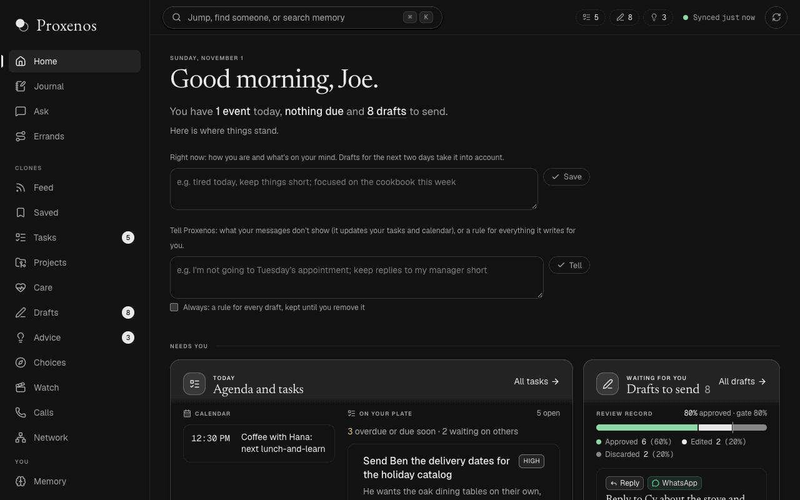

| Care: where things stand, what's yours to do, what to say | Errands: carried as far as they go, one tap short of sending |
|---|---|
| 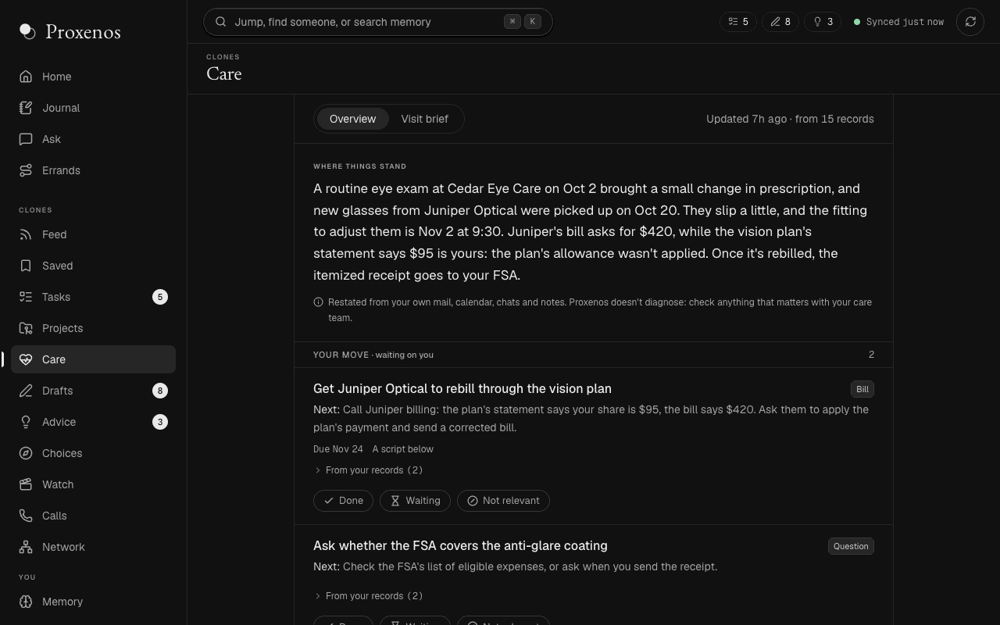 | 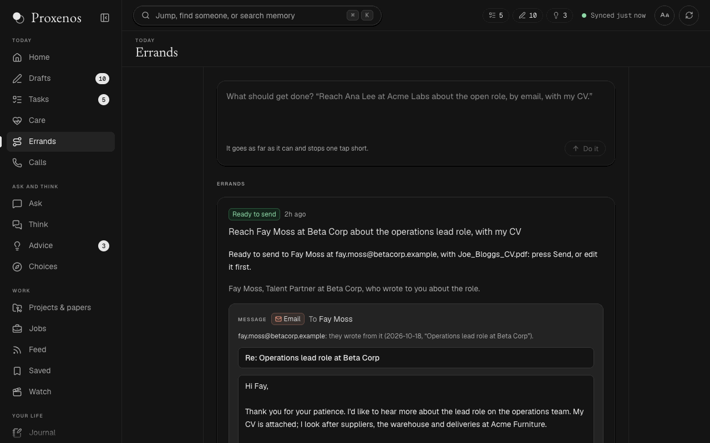 |
| **Drafts: replies and documents in your voice, ready to send** | **Tasks: what was asked of you, pulled from your conversations** |
| 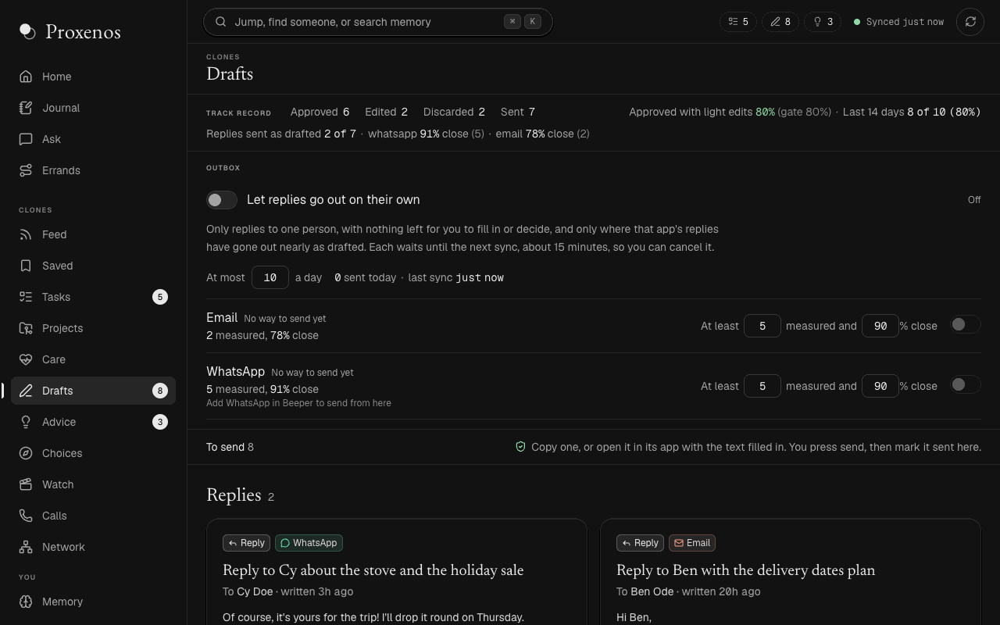 | 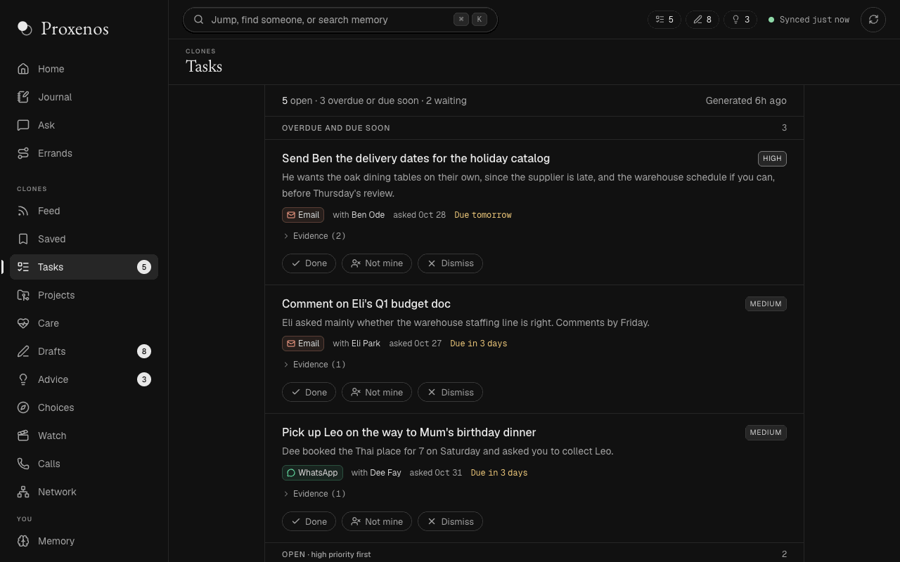 |
| **Projects & papers: each one where it stands, and its next step on a branch** | **Jobs: every lead, whether to apply, with which CV and through whom** |
| 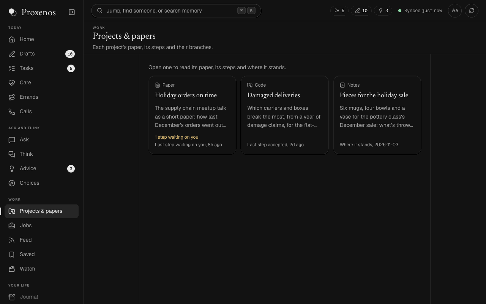 | 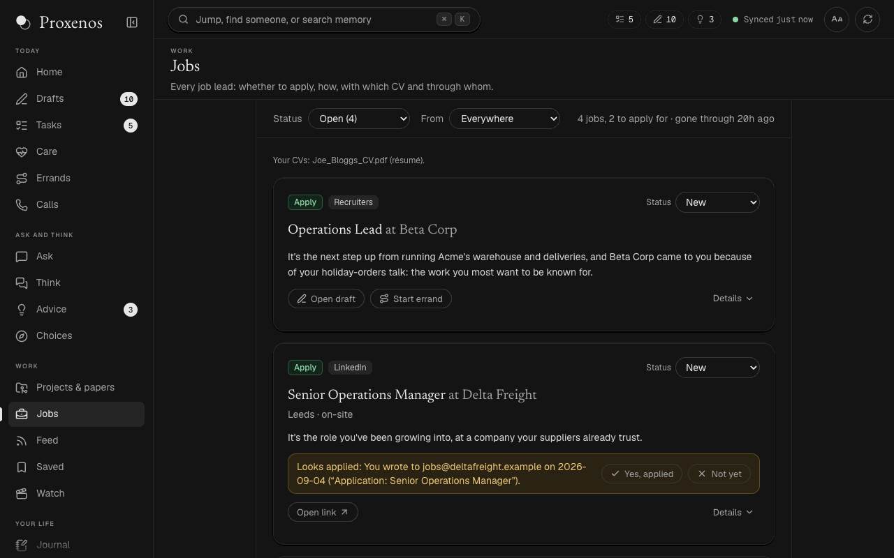 |
| **Life: a diary of each month, in your own voice** | **Rhythms: your weeks side by side, and a card for each month** |
| 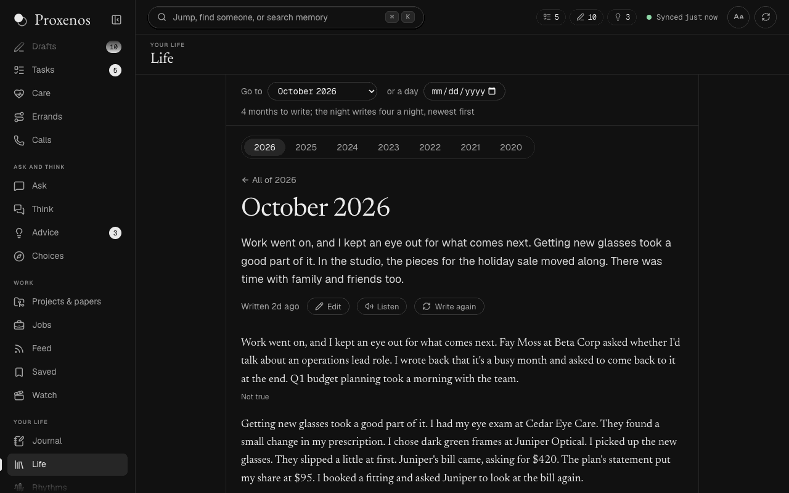 | 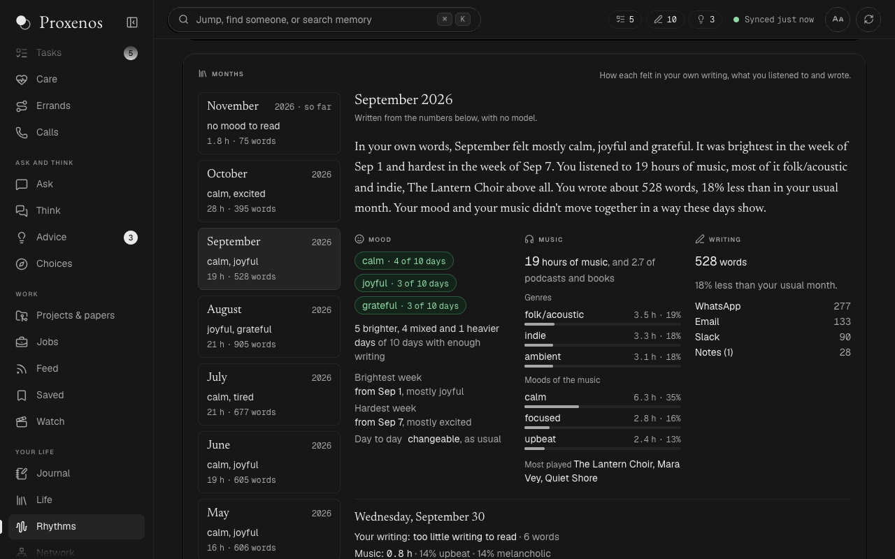 |

**Journal: the day, written down, from what Proxenos already tracks**

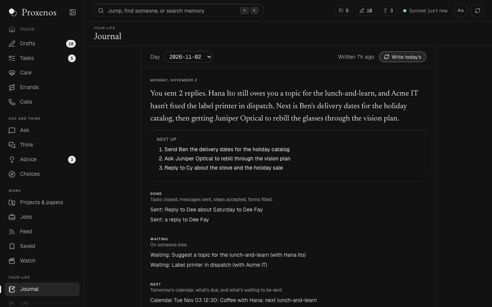

On a phone, over `proxenos phone`:

<p>
  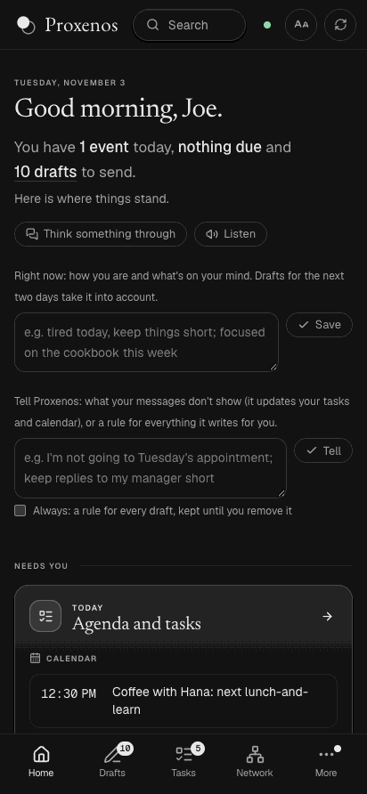
  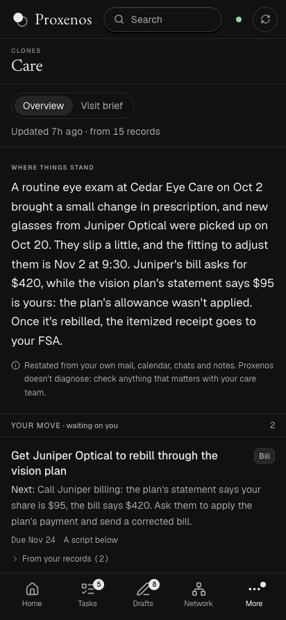
  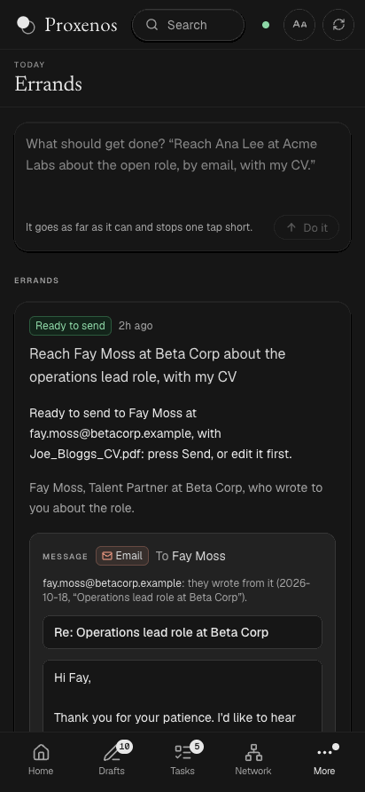
  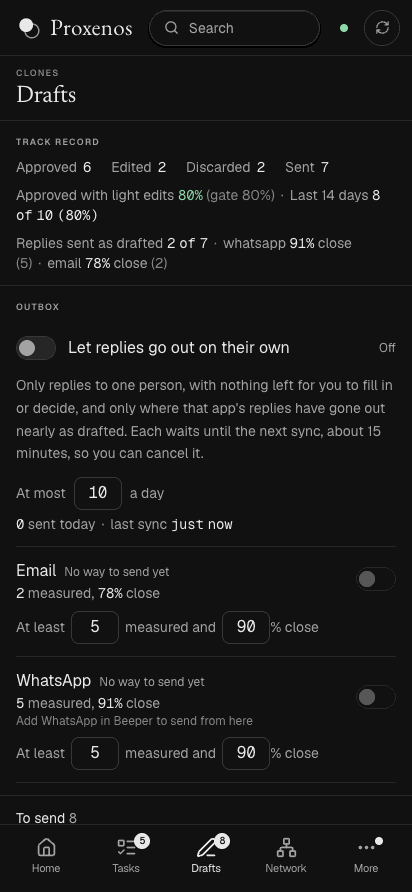
  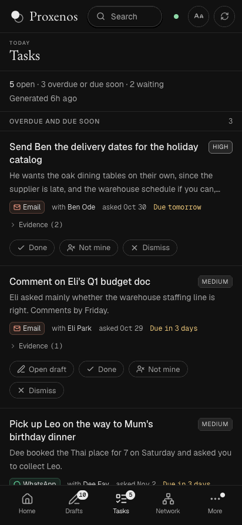
</p>
<p>
  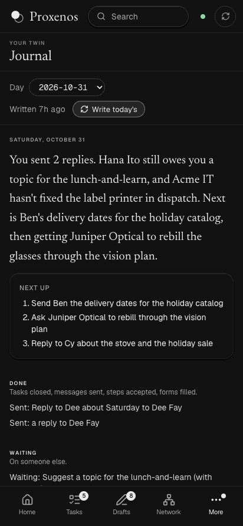
  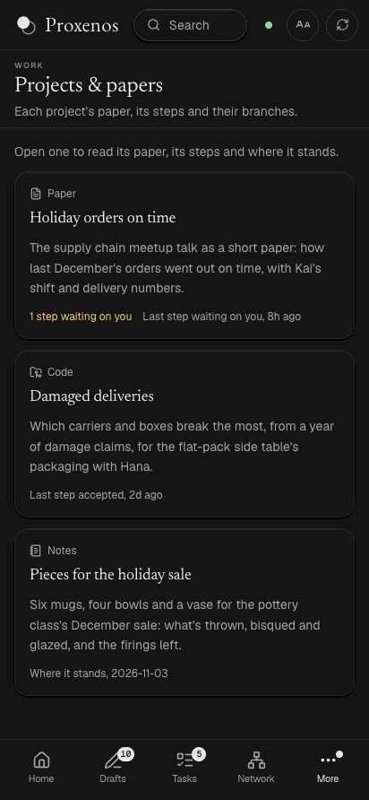
  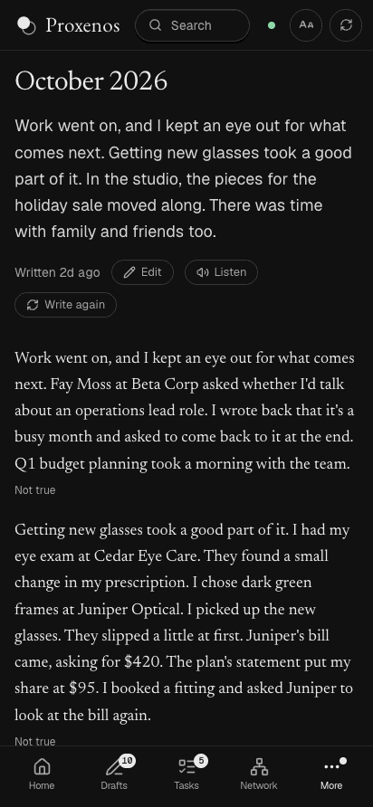
  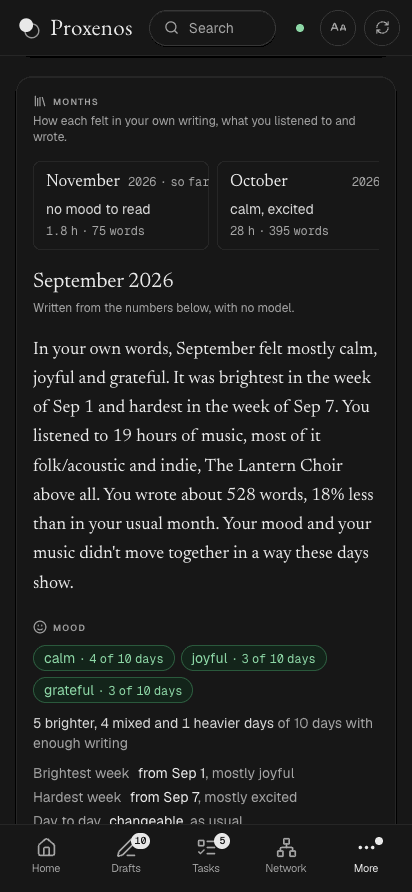
  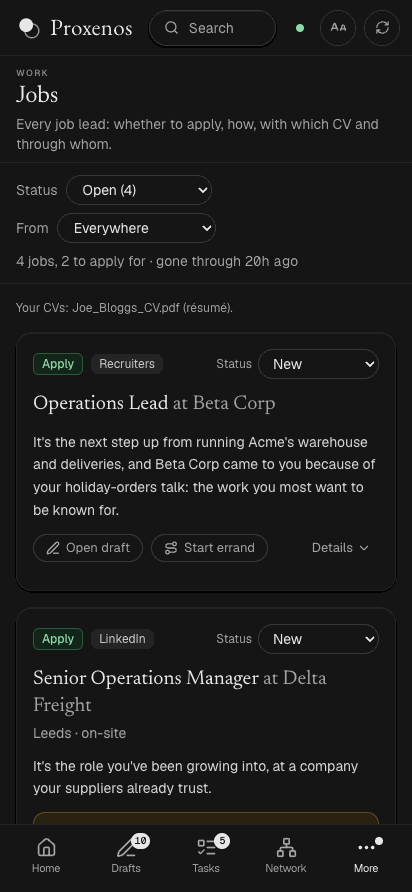
</p>

## How it fits together

```
your sources ──ingest──▶ vault/raw ──observe──▶ notes ──consolidate──▶ self-model
                              │                                             │
                              └──index──▶ memory (full-text search)         ▼
                                                        clones: feed, tasks, advice,
                                                        choices, jobs, watch,
                                                        network, recall, projects, project
                                                        steps, errands, offers, drafts,
                                                        journal, life, rhythms
                                                                │
                                                        local page (127.0.0.1)
```

- **Ingesters** pull each source into the vault as monthly files. Re-running one is always safe.
- **Observers** read one month of one source (only your own side of conversations) and write notes about you.
- **The master** merges the notes into a single self-model: identity, interests, taste, voice, routines and open questions. Slow-changing parts change only through proposals you accept.
- **Clones** read the self-model and each do one job. The page shows their output and records your reactions, which feed back into the next run.

More detail: [architecture](architecture.md), [memory](memory.md), [data sources](data_sources.md), [the feed and the page](tracker.md), [a voice model trained on your own writing](voice-model.md), [related work](landscape.md).

## Install from source

**One command**, on a Mac with [Homebrew](https://brew.sh):

```bash
git clone https://github.com/mindemory/proxenos && cd proxenos && scripts/install.sh
```

It installs what's missing (Node, Ollama's own app, and Miniforge if there's no conda), sets up the `proxenos` env and the page's packages, and pulls a local model that fits your Mac's memory. Then `conda activate proxenos && proxenos web`. Add `--start-at-login` to keep the page and a sync running from login on, or `--no-model` to use a hosted model instead. Running it again only adds what's missing.

**By hand**, step by step. Requirements: macOS, Python 3.12 (conda shown here), Node 22+, and a model for the steps that use one: an open model on your Mac through [Ollama](https://ollama.com) (no key, nothing leaves the computer; `gemma4:26b` fits a 32 GB Mac), or an Anthropic API key. Use Ollama's own app, not Homebrew's `ollama` formula, whose build can't hold a model to the JSON shape a step asks for. Another app that serves OpenAI's API on this computer works too: LM Studio, llama.cpp's `llama-server`, Jan, LocalAI or vLLM, as `PROXENOS_MODEL=local:<name>` at `PROXENOS_LOCAL_URL` (LM Studio's `http://127.0.0.1:1234/v1` unless you set another, such as `llama-server`'s `http://127.0.0.1:8080/v1` or vLLM's `http://127.0.0.1:8000/v1`). Load the model there with a context of 65,536 tokens. Search by meaning still embeds through Ollama.

```bash
git clone https://github.com/mindemory/proxenos && cd proxenos
CONDA_SUBDIR=osx-arm64 conda env create -f environment.yml
conda activate proxenos
pip install -e ".[dev]"
brew install --cask ollama-app && open -a Ollama && ollama pull gemma4:26b   # the local model
ollama pull qwen3-embedding:0.6b   # search memory by meaning (optional)
proxenos web                    # http://127.0.0.1:4747; leave it open, and use another window below
```

The first time, the page asks three things: your name, where the vault lives (`~/proxenos_vault` unless you pick another folder; it warns about folders iCloud syncs), and a model, either one on this computer, through Ollama or another app's server, or an Anthropic API key, checked with one small call. It lists the local models it finds with their sizes, marks the ones too big for this computer's memory and suggests the largest that fits; with none yet, it says what size to get. The model can wait: sources still sync and search still works, but nothing is drafted. Then it opens Connect for a first source. Settings go to `~/Library/Application Support/Proxenos/settings.json` and keys and tokens to the macOS Keychain, one item each; change them later in Settings. (On Windows they go to `%APPDATA%\Proxenos\settings.json` and Credential Manager; on Linux, to `~/.config/proxenos/settings.json` and the Secret Service.)

Prefer a file? `cp .env.example .env` and fill it in. Running from source, `.env` is read before the settings file and the Keychain, and with one there, changes from the page are written to it.

**Try it without your data:** `proxenos demo` writes a vault of made-up records (the one in the pictures above) to a temporary folder, with no model and no `.env`, and prints the command that opens the page on it, on port 4848 so it can run beside your own. Nothing is ever sent from it.

## Adding your data

Add data in any order. Each source works on its own:

```bash
proxenos ingest whatsapp        # reads the WhatsApp Mac app's local store
proxenos import ~/Downloads/takeout-*.zip   # Google Takeout: mail, calendar, Drive, YouTube, ...
proxenos sync                   # imports anything dropped into data/, refreshes every source
```

Some sources read a folder on your computer: a folder of documents, your website's repo, a Spotify export, slackdump runs. Set them in Settings, or in `.env` as `PROXENOS_DOCS_DIRS`, `PROXENOS_WEBSITE_REPO`, `PROXENOS_SPOTIFY_EXPORT` and `PROXENOS_SLACKDUMP_DIR`. To have plans from your messages land on one of your calendars, set `PROXENOS_PLANS_CALENDAR` to its name in the Mac's Calendar app, which syncs it to its account (Google, Exchange, iCloud); otherwise subscribe to the page's `/api/plans.ics`. `.env.example` lists every setting.

Each source, and how it gets in:

| Source | How it gets in |
|---|---|
| WhatsApp | The Mac app's local database (`proxenos ingest whatsapp`) |
| Slack | [slackdump](https://github.com/rusq/slackdump) (`proxenos auth slackdump WORKSPACE`, then kept current every sync), or a user token |
| Gmail, Google Calendar, Drive, Photos metadata, Keep, Tasks, YouTube, Chrome | Google Takeout zips (`proxenos import`) |
| Email (any) | mbox exports; Gmail over IMAP with an app password or a Google sign-in (`proxenos auth gmail`) |
| Microsoft 365, Outlook.com | Mail and calendar through Microsoft Graph, with a read-only sign-in to your own app registration (`proxenos auth microsoft NAME ADDRESS`), then kept current every sync. No mail app needed, so it works on any computer |
| Google Calendar, live | The Calendar API with a read-only Google sign-in, apart from Gmail's (`proxenos auth gcalendar NAME ADDRESS`), then kept current every sync |
| Apple Mail | Every account in the Mac's Mail app (Gmail, Google Workspace, Microsoft 365, Outlook), with no sign-in of its own: add the accounts in System Settings, Internet Accounts, keep Mail open (or set to open at login) so it fetches, and give the Python that runs Proxenos Full Disk Access. `proxenos sync` then reads it every run. |
| Health records | Apple Health's export (Health Records from your providers), or the FHIR files a patient portal lets you download (`proxenos import`, or `proxenos ingest healthrecords --export PATH`): results, conditions, medications, visits and reports, for the care view |
| Spotify | Your latest plays live, once you sign in through your own Spotify app (`proxenos auth spotify`); your whole history from the Extended Streaming History export |
| LinkedIn, X, Instagram, Facebook, Threads | Each service's data export; Instagram, Messenger, X and LinkedIn chats live through [Beeper Desktop](https://www.beeper.com) (free for up to five accounts) |
| Bluesky | Public posts by handle |
| Notion, Obsidian, PDFs | Exports or folders |
| Letterboxd | Data export, and your public diary feed by username (`PROXENOS_LETTERBOXD_USER`), which sync reads every run so new logs come in without one |
| ChatGPT, Claude | Each one's data export (ChatGPT: Settings, Data controls, Export data; Claude: Settings, Privacy, Export data); drop the zip in `data/` |
| Calendar, live | Any account in the Mac's Calendar app (Google, Exchange, iCloud), read every sync once Proxenos's Python has Full Disk Access |
| Personal website, papers and mentions | A local site repo; OpenAlex and news search |
| Strava (optional) | API (`proxenos auth strava`): walks, runs and rides, the least of what Proxenos reads |

See [docs/data_sources.md](data_sources.md) for each one's details.

## Building the model and the clones

Then build the model and the clones:

```bash
proxenos master                 # notes per month, then the self-model
proxenos clone tracker          # also: tasks, care, advisor, network, choices, jobs, watch, recall, projects, work
```

## Projects and papers

Your long-running projects are a list you keep in the vault, `clones/projects/projects.json`: each with an id, a name, what it's about, its people and the words that name it, and a group if you like ("PhD", "Postdoc"), which the page lists them under. A `brief.md` in the project's folder says what's known around it, the question and the first analyses; the night reads it, and the project's page shows it. Each night Proxenos writes where each one stands, from what your messages say and, given its code's folder, the commits on every branch since the last run. Give one its data folders too, and it also does the work, a step a night, on a branch of its own, and brings it back for you to accept on the page's Projects view:

```json
{"id": "calls-paper", "name": "The calls paper", "about": "...", "people": ["Ana Lee"],
 "repo": "~/code/calls", "data": ["~/data/calls"], "python": "~/envs/calls/bin/python",
 "notes": "F*.py make the paper's figures.",
 "manuscript": {"path": "docs/paper/paper.md", "branch": "paper"}}
```

A project with code also has its manuscript one click away: **Manuscript** on the Projects view shows the paper's old version and its new one, the changes between them marked (what came in highlighted, what went struck through, word by word), and a picker for any two versions. It's the file `"manuscript"` names, else the newest `paper.md`, `manuscript.md` or `main.tex` (or a `.tex` under `paper/` or `manuscript/`) on any branch, read with git, so the draft can be on a branch your checkout isn't on. Change it there in either of two ways: ask for a change in your words, which a step does on a branch from the manuscript's, or edit the text and save, which commits it on a branch of its own, `proxenos/<project>-edit-<when>`. Either waits on you as a step, with **See the changes** beside Accept and Discard, and **Revise this step** to ask for more on top of it. Accept merges into the manuscript's branch, once your checkout is on it. Nothing touches your checkout until then, and nothing is pushed. `proxenos project manuscript ID` prints the same as JSON.

To write with co-authors the way you already do, sign in to Google Docs once and press **Open in Google Docs** on the manuscript: it goes to your own Drive as a Google Doc, yours alone until you share it from Docs, and opens in a new tab. Edit, comment and share it as usual. **Bring back its changes** puts what changed in the doc on a branch of its own, from the version it was made from, and it waits on you as a step like any other edit: only the paragraphs changed in Docs change, and the rest keeps its own Markdown or LaTeX to the byte. The doc's comments show beside it, with who said what about which passage. Git stays the source of truth ([docs/data_sources.md](data_sources.md#a-manuscript-in-google-docs)).

To keep every project in a cloud drive you already sync on this computer (Google Drive for desktop, Dropbox, OneDrive or iCloud Drive), set its folder in Settings, under Projects (or `PROXENOS_PROJECT_FOLDER`), and install pandoc (`brew install pandoc`), which makes the Word files, and tectonic (`brew install tectonic`), which makes the PDFs. Each night each project gets a folder there, under its group: its manuscript at its branch's tip as a `.docx` and as a PDF made from the same commit, so the two always match (with nothing here to make PDFs, the one committed beside it comes instead), where it stands, what's known and the question, its open drafts, and what it's about. Read, edit, comment on and share them in Word or Google Docs. The tables, figures and data files a manuscript names, by file name (`results/S1_table.csv`) or by a label the file's name carries (`Table S4` finds `S02_tableS4_note_types.csv`, `Fig. S2` finds `FigS2_calls.png`), are copied from its repository into a `Supplement` folder beside it, all but the figures the manuscript shows itself, and its tables and figures are shown in `Supplementary information.docx` and its PDF, each under the caption the manuscript gives it, a long table cut short; with only data files left, there's no such document. Both PDFs are made again only when what they're made from changes. A project marked `"cloud": false` on the list, such as an immigration petition, never goes there. What you change in a Markdown manuscript comes back the next night as a step on a branch of its own, only the paragraphs you changed changed; a LaTeX one is made with its citations and references written out, so its edits go one way. Comments you leave on either come back the next night as a step that makes the change in the paper itself, with the passage each is on and who left it; resolved ones are left out. Nothing you changed is written over: a note you edited stays as you left it, and when the paper moves on in git, your copy moves to `Earlier/` with the date before the newer one is written ([docs/data_sources.md](data_sources.md#your-projects-in-a-cloud-drive)).

## Keeping it running

To keep it running without a terminal, run `scripts/install-app.sh`: the page and a sync every 15 minutes then start at login. `scripts/build-mac-app.sh` then builds Proxenos.app into ~/Applications: the page in a window of its own, with a Dock icon and menus, no browser. `desktop/build.sh` builds the coming one-download app instead: an Electron app with its own Python inside, a menu-bar menu (Open, Sync now, Pause, Quit) and the sync and night built in, as a Mac `.dmg` or a Windows installer. It's unsigned until the owner's signing accounts exist, so macOS asks you to allow it under Privacy & Security first ([docs/apps.md](apps.md)). To reach it from your phone, put [Tailscale](https://tailscale.com/download) on both, signed in to the same account, and run `proxenos phone`: the page gets a private address only your own devices can open, and Chrome on the phone can add it to the home screen.

`proxenos night` runs the whole loop. `scripts/install-night.sh` schedules it every night with launchd.

`proxenos schedule` does the same on any computer, with no launchd: a sync every 15 minutes and the night at 01:30, run once on waking if the computer slept through either, and never two at once (nor beside one launchd or a terminal started). Leave it running in a window, or start it at log-on with Task Scheduler on Windows or a systemd user unit on Linux ([docs/apps.md](apps.md#keeping-it-running-from-source)); the coming Mac and Windows apps will run it themselves. `proxenos schedule --once` runs whatever is due and exits.

`px` is a short alias for `proxenos`.

## Development

```bash
pytest                                   # tests use synthetic data only
ruff check src tests
npm --prefix web run lint && npm --prefix web run build
```

The same checks run on GitHub for every push and pull request.

`scripts/screenshots.sh` retakes the pictures here, under [What it looks like](#what-it-looks-like), and the README's, from the demo vault with headless Chrome (it needs Google Chrome and a Python with Pillow). Open each one before committing it.

For AI coding agents, [AGENTS.md](../AGENTS.md) maps the repo, its commands and its rules, and [llms.txt](../llms.txt) indexes the docs.

## Built on

Proxenos stands on other people's open-source work: Next.js, React, Tailwind, Ollama, slackdump, Beeper's local API, OpenAlex, mlx-lm and more. Each is credited, with its licence, in [ACKNOWLEDGMENTS.md](../ACKNOWLEDGMENTS.md). Code taken from elsewhere keeps its licence and copyright notice, and is listed there too.
